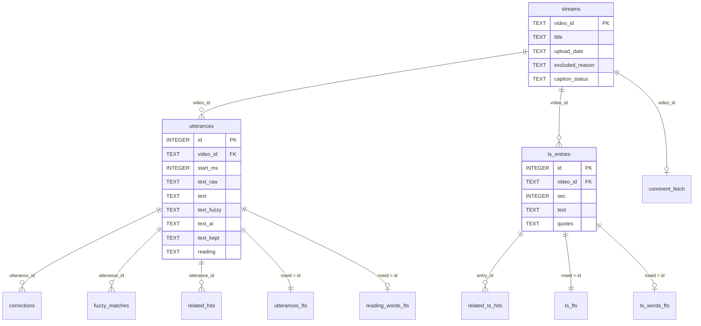

# AZKi Moment Search エンティティ一覧

| 項目 | 内容 |
|---|---|
| 対象 | `AZKiMomentSearch` のコミット `e55a5a4`（2026-11-11。リモートは無く、この PC の中だけにある） |
| 版 | 第 2 版（2026-11-11）。第 1 版（2026-11-02）を置き換える |
| 根拠 | `src/azkims/db.py` などの実コードと、`data/azkims.sqlite`・`data/turso_upload.sqlite` の実データ（読み取り専用で確認） |
| 関連文書 | [画面設計書](02_画面設計書.md) / [機能設計書](03_機能設計書.md) / [API設計書](04_API設計書.md) / [単体テスト設計書](05_単体テスト設計書.md) |

件数は 2026-11-10 20:14（JST）に作られた DB の実測値です。将来の値は比例計算の見込みで、実測ではありません。

## 1. データの置き場所

| # | 置き場所 | 中身 | 消えたときの影響 |
|---|---|---|---|
| 1 | `data/captions/`、`data/comments/` | 字幕とタイムスタンプコメントの原本 | **再取得が必要**。字幕は 1 本 20〜35 秒の間隔で取るので、全件で数日かかる |
| 2 | `data/llm/` | LLM（Claude Haiku）が出した AI修正 の修正案 | **作り直しに LLM の利用枠が要る**。全件 1 周で Pro プランの週の使用量の約 27%（DESIGN.md の記録） |
| 3 | `config/dictionary/`、`config/oshi_marks.toml`、`config/config.example.toml` | 辞書、補正の採否、推しマーク、設定（git 管理） | git から戻せる。ただしリポジトリはこの PC の中だけにある |
| 4 | `data/azkims.sqlite` | 手元の検索 DB。1〜3 から `azkims build` で作り直せる（`streams`、`comment_fetch` を除く） | `build` で復元。`streams`、`comment_fetch` は `sync` からやり直し |
| 5 | Turso の DB、Vercel の環境変数 | 公開用 DB（4 の縮小版）と読み取り用トークン | `azkims publish` で作り直せる |
| 6 | 利用者のブラウザ（localStorage） | お気に入り、配色 | 復元できない。サーバーには送らない |

**リポジトリの複製がどこにも無い点に注意してください。** 2026-11-11 に、それまで未コミットだった変更（83 ファイル）と AI修正 を作るスクリプト（`tools/llm/`）をコミットしました（`e55a5a4`）。ただし git のリモートが無いので、この PC が壊れると 1〜5 の原本・DB・リポジトリがまとめて失われます。PC の外への複製は、まだ決まっていません。

## 2. ER 図



`meta` は他の表と関係を持たない key-value 表です。

## 3. エンティティ一覧

| ID | 物理名 | 論理名 | 種類 | 作り直し | 実件数 | 公開用 DB |
|---|---|---|---|---|---|---|
| E01 | `streams` | 配信 | 表 | 残す | 838 | 589（対象かつ字幕取得済みのみ） |
| E02 | `comment_fetch` | コメント取得状況 | 表 | 残す | 295 | 含めない |
| E03 | `meta` | メタ情報 | 表 | 一部を build で更新 | 5 | 7 |
| E04 | `utterances` | 発言 | 表 | build ごと | 694,767 | 同じ |
| E05 | `utterances_fts` | 発言の全文索引 | FTS5（trigram、外部コンテンツ） | build ごと | E04 と同数 | 同じ |
| E06 | `reading_words_fts` | 語単位の読み索引 | FTS5（unicode61、contentless） | build ごと | E04 以下 | 同じ |
| E07 | `corrections` | 確定補正の記録 | 表 | build ごと | 21,303 | 含めない |
| E08 | `fuzzy_matches` | 補正候補の記録 | 表 | build ごと | 3,123 | 同じ |
| E09 | `related_hits` | 関連語の一致（発言） | 表 | build ごと | 24,019 | 同じ |
| E10 | `ts_entries` | タイムスタンプの行 | 表 | build ごと | 49,353 | 同じ |
| E11 | `ts_fts` | タイムスタンプの全文索引 | FTS5（trigram、外部コンテンツ） | build ごと | E10 と同数 | 同じ |
| E12 | `ts_words_fts` | タイムスタンプの語単位の読み索引 | FTS5（unicode61、contentless） | build ごと | E10 以下 | 同じ |
| E13 | `related_ts_hits` | 関連語の一致（タイムスタンプ） | 表 | build ごと | 6,666 | 同じ |

- 「build ごと」の表は、`db.reset_utterances` が毎回 DROP → CREATE します。スキーマ変更にマイグレーションは要りません。
- **発言とタイムスタンプの `id` は build のたびに変わります。** お気に入りが `id` を使わないのはこのためです。
- 発言の `id` は「配信日の新しい順 → video_id → 開始時刻」の順に振ります（`meta.utterance_order`）。検索が `id` の順に読むだけで新しい順になり、一致を全部読まずに止められるようにするためです。

### 3.1 規模

| 項目 | 値 | 状態 |
|---|---|---|
| 一覧にある配信 | 838 | DB で確認 |
| 検索対象の配信 | 606 | DB で確認 |
| うち字幕取得済み | 589 | DB で確認 |
| うち字幕なし | 15 | DB で確認 |
| うち未取得 | 2 | DB で確認 |
| 除外: 歌枠・ライブ（`singing`） | 142 | DB で確認 |
| 除外: メンバー限定（`members_only`） | 84 | DB で確認 |
| 除外: 手動（`manual`） | 6 | DB で確認 |
| 手元の DB | 582 MB | ファイルで確認 |
| 公開用 DB | 507 MB | ファイルで確認 |
| 配信の増加 | 週 2〜4 本 | DESIGN.md の記載 |
| 1 年後の発言数 | 約 81〜93 万件 | 見込み。1 本あたり約 1,180 件 × 年 100〜200 本の比例計算 |
| 1 年後の公開用 DB | 約 590〜680 MB | 見込み。同じ比例計算 |

> **前提の食い違い:** `CLAUDE.md` は最終規模を「配信 622 本以上」としています。2026-11-09 にライブ本番を除外したため、今の検索対象は 606 本です。過去の配信はほぼ取り終えており（未取得 2 本）、今後は新しい配信の分だけ増えます。最終規模の数字を見直すかどうかは、利用者の判断が要ります。

## 4. テーブル定義

列の「必須」は `NOT NULL` の有無です。定義元は [db.py:10](../../src/azkims/db.py:10) と [db.py:46](../../src/azkims/db.py:46) です。

### E01 streams（配信）

YouTube の配信 1 本につき 1 行です。`sync` が作り、`fetch` が更新します。

| 列 | 型 | 必須 | 説明 | 値の例 |
|---|---|---|---|---|
| `video_id` | TEXT | PK | YouTube の動画 ID | `M4utnSkzW-U` |
| `title` | TEXT | ○ | 配信タイトル | 【新・都道府県ゲーム】… |
| `list_order` | INTEGER | | チャンネル一覧での順番。0 が最新 | 0 |
| `upload_date` | TEXT | | 配信日 `YYYY-MM-DD`。`fetch` で入る | 2026-11-05 |
| `duration_sec` | INTEGER | | 長さ（秒） | 7200 |
| `availability` | TEXT | | 公開範囲 | `public`、`subscriber_only` |
| `live_status` | TEXT | | 配信の状態 | `was_live`、`is_upcoming` |
| `excluded_reason` | TEXT | | NULL なら検索対象。[コード値](#9-コード値) を参照 | `singing` |
| `caption_status` | TEXT | | 字幕の取得結果。NULL は未取得 | `ok` |
| `caption_error` | TEXT | | 取得エラーの内容（公開用 DB には含めない） | |
| `fetched_at` | TEXT | | 字幕の取得日時（UTC、ISO 8601） | 2026-11-09T23:40:00+00:00 |

配信日が新しすぎる（`fetch.min_age_days` = 3 日以内）配信は、取得しても `caption_status` を NULL に戻し、次回に取り直します。

### E02 comment_fetch（コメント取得状況）

| 列 | 型 | 必須 | 説明 |
|---|---|---|---|
| `video_id` | TEXT | PK、FK → streams | 配信 |
| `status` | TEXT | ○ | `ok` / `editing` / `none` / `error`。[コード値](#comment_fetchstatusコメントの取得状況) を参照 |
| `comment_count` | INTEGER | | 保存したコメント数 |
| `error` | TEXT | | エラー内容 |
| `fetched_at` | TEXT | | 取得日時 |

実データ: `ok` 245 本（コメント 344 件）、`editing` 4 本（6 件）、`none` 46 本、`error` 0 本。

### E03 meta（メタ情報）

| key | 値 | 書き込む処理 | 手元 | 公開用 |
|---|---|---|---|---|
| `built_at` | build の日時（UTC） | `pipeline.build` | ○ | ○ |
| `dictionary_terms` | 辞書の語数（現在 1,601） | `pipeline.build` | ○ | ○ |
| `utterance_order` | 発言の `id` の振り順。`upload_date DESC, video_id, start_ms` | `pipeline.build` | ○ | ○ |
| `included_only` | `"1"` なら、発言は検索対象の配信のものだけ | `pipeline.build` が書き、`reclassify` が消す | ○ | ○ |
| `members` | 「ホロメンから探す」の一覧（JSON。現在 71 人） | `pipeline.build` | ○ | ○ |
| `utterance_count` | 発言数 | `deploy.export_slim_db` | × | ○ |
| `timestamp_count` | タイムスタンプ数 | `deploy.export_slim_db` | × | ○ |

`included_only` と `utterance_order` は、検索が読む行数を減らすための目印です。

| key | 検索側の使い方 |
|---|---|
| `included_only` | `count_tiers` が配信の表と結合しなくて済む（配信名・日付の絞り込みが無いとき） |
| `utterance_order` | 一致タブを新しい順に読むとき、索引の順に読んで 20 件で止められる |

`members` の 1 人分の形は次のとおりです。

```json
{ "name": "ときのそら", "mark": "🐻💿", "nickname": "そらちゃん", "count": 786 }
```

`nickname` は名前・呼び名のうち、AZKi の字幕に最も多く出るものです。`count` は名前・呼び名の一致の合計です。

### E04 utterances（発言）

字幕を発言単位に区切った、このシステムの中心の表です。**補正の段階ごとに別の列を持ちます。** 字幕の原文を失わず、どの段階で一致したかを信頼度として示すためです。

| 列 | 型 | 必須 | 説明 | 値のある行 |
|---|---|---|---|---|
| `id` | INTEGER | PK | 発言 ID。build のたびに振り直す | 全行 |
| `video_id` | TEXT | ○、FK → streams | 配信 | 全行 |
| `start_ms` | INTEGER | ○ | 開始時刻（ミリ秒） | 全行 |
| `end_ms` | INTEGER | ○ | 終了時刻（ミリ秒） | 全行 |
| `text_raw` | TEXT | ○ | 字幕原文（正規化のみ）。公開用 DB では `text` と同じなら空文字 | 全行 |
| `text` | TEXT | ○ | 確定補正後。alias、文脈つき補正ルール、かな表記ゆれの補正を適用 | 全行 |
| `text_fuzzy` | TEXT | | 候補補正後。候補が無ければ NULL | 2,892 |
| `text_orig` | TEXT | | 補正で変わった発言だけ原文を入れる検索用の列 | 18,712 |
| `text_ai` | TEXT | | **AI修正**。LLM の修正案を `text` に当てたもの。無ければ NULL | 47,844 |
| `fuzzy_distance` | INTEGER | | 補正候補の読み編集距離の最大値 | 2,892 |
| `reading` | TEXT | ○ | `text` の読み（`fold_reading` 済み）。`text_ai` があれば、その読みを改行でつなぐ | 全行 |
| `text_kept` | TEXT | | **スパチャ読み**の名前の連続を除いた残り。原文・補正後・候補補正後を改行でつなぐ。連続が無ければ NULL | 6,029（うち全体が読み上げで空文字 2,279） |
| `reading_kept` | TEXT | | `text_kept` の読み | 6,029 |

索引: `idx_utterances_video (video_id, start_ms)`

### E05 utterances_fts（発言の全文索引）

| 項目 | 内容 |
|---|---|
| 索引する列 | `text`, `text_fuzzy`, `text_orig`, `text_ai`, `reading` |
| トークナイザ | `trigram`（3 文字単位）。3 文字未満は索引で引けない |
| 使い道 | 3 文字以上の語の部分一致、bm25 による関連度、`rowid` 順の読み出し |

`text_ai` は別の表にせず、この索引の列にしています。Turso の読み取りは一致した発言の数に比例し、列を足しても読む行は増えないためです（DESIGN.md 5.11。AI修正 の追加後の増加は実測で 0〜3%）。

### E06 reading_words_fts（語単位の読み索引）

| 項目 | 内容 |
|---|---|
| 列 | `words`（語の読みを空白区切りで連結） |
| トークナイザ | `unicode61 remove_diacritics 0` |
| 内容の保持 | なし（`content=''`）。`rowid` だけ得られる |
| rowid | `utterances.id` |
| 使い道 | 読みが「語の境界で」一致したかの判定（tier 3）、読み 2 文字の語の前方一致 |

登録する読みは、Sudachi の長単位・短単位それぞれの 1〜4 トークンの連なりです。助詞・助動詞・記号で始まる連なりや終わる連なりは登録しません。`text_ai` がある発言は、その読みの連なりも加えます。

### E07 corrections（確定補正の記録）

| 列 | 型 | 必須 | 説明 |
|---|---|---|---|
| `utterance_id` | INTEGER | ○、FK → utterances | 発言 |
| `surface` | TEXT | ○ | 字幕の表記 |
| `canonical` | TEXT | ○ | 補正後の語 |

レビュー用です。公開用 DB には含めません。

### E08 fuzzy_matches（補正候補の記録）

| 列 | 型 | 必須 | 説明 |
|---|---|---|---|
| `utterance_id` | INTEGER | ○、FK → utterances | 発言 |
| `surface` | TEXT | ○ | 字幕の表記 |
| `canonical` | TEXT | ○ | 候補の語 |
| `distance` | INTEGER | ○ | 読みの編集距離 |
| `in_title` | INTEGER | ○ | 配信の話題にその語があるか（1/0） |

索引: `idx_fuzzy_pair (surface, canonical)`。`azkims review`、`triage` の集計元で、検索結果の `candidates` にも使います。

### E09 related_hits（関連語の一致: 発言）

| 列 | 型 | 必須 | 説明 |
|---|---|---|---|
| `tag` | TEXT | ○ | タグ（ホロメンかユニットの名前） |
| `word` | TEXT | ○ | 一致した関連語 |
| `utterance_id` | INTEGER | ○、FK → utterances | 発言 |
| `confident` | INTEGER | ○ | 1: 確からしい（関連語タブ）/ 0: 話題でない配信の weak の語（もしかしてタブ） |

索引: `idx_related_hits (tag, confident, word)`。実データ: `confident=1` が 21,024 行、`0` が 2,995 行、一致のあるタグは 87 種。スパチャ読みの名前の連続の部分は探しません（`text_kept` を使う）。

### E10 ts_entries（タイムスタンプの行）

人が書いたタイムスタンプコメントの 1 行です。字幕とは別の層として検索します。

| 列 | 型 | 必須 | 説明 |
|---|---|---|---|
| `id` | INTEGER | PK | 行 ID。build のたびに振り直す |
| `video_id` | TEXT | ○、FK → streams | 配信 |
| `sec` | INTEGER | ○ | 時刻（秒） |
| `text` | TEXT | ○ | 本文（スタンプを除去し正規化） |
| `quotes` | TEXT | ○ | 「」内の語句を改行区切りで保持 |
| `is_note` | INTEGER | ○ | 1 なら時刻なしの補足行 |
| `reading` | TEXT | ○ | 読み |

索引: `idx_ts_video (video_id, sec)`

**掲載範囲の制約:** 検索に出してよいのは、霧島リンカさん本人が書いたモンハンワイルズ（2025-03-17）以降の分だけです。`config` の `author_ids` で投稿者を絞っています。実データの範囲は 2025-03-17〜2026-11-05 の 249 配信で、制約どおりです。`（編集中）` の版も、完成版が来るまではその版を使います。

### E11 ts_fts / E12 ts_words_fts

`utterances_fts` と `reading_words_fts` のタイムスタンプ版です。`ts_fts` の索引列は `text`, `reading` です。

### E13 related_ts_hits（関連語の一致: タイムスタンプ）

| 列 | 型 | 必須 | 説明 |
|---|---|---|---|
| `tag` | TEXT | ○ | タグ |
| `word` | TEXT | ○ | 一致した関連語。**推しマーク**（🌸 など）の場合もある |
| `entry_id` | INTEGER | ○、FK → ts_entries | タイムスタンプの行 |
| `confident` | INTEGER | ○ | E09 と同じ。検索で使うのは `1` だけ |

索引: `idx_related_ts_hits (tag, confident, word)`。推しマークのある行は、そのホロメンの確かな一致として入ります（2026-11-10 追加）。実データ: `confident=1` が 6,488 行、`0` が 178 行。

## 5. 公開用 DB と手元の DB の違い

`deploy.export_slim_db` が手元の DB から公開用 DB を作ります（[deploy.py:46](../../src/azkims/deploy.py:46)）。

| 対象 | 手元の DB | 公開用 DB |
|---|---|---|
| `corrections`、`comment_fetch` | あり | **削除** |
| `streams` の行 | 全 838 配信 | 検索対象かつ字幕取得済みの 589 配信 |
| `streams` の列 | 全 11 列 | 7 列。`availability`、`live_status`、`caption_error`、`fetched_at` を削除 |
| `streams` の主キー | `video_id` | 主キーなし。代わりに一意索引 `idx_streams_video` |
| `utterances.text_raw` | 常に原文 | 補正後と同じなら空文字。読むときに `search.RAW_SQL` で `text` に読み替える |
| `meta` | 5 件 | 7 件（件数を追加） |
| FTS 索引 | そのまま | `optimize` を実行 |
| 字幕・コメントの原本、LLM の修正案 | ファイルで保持 | 含まない |

除外した配信の発言は、build がそもそも作らなくなりました（前回の課題 ISS-01 の修正）。実データでも、除外配信の発言とタイムスタンプは手元・公開用とも 0 件です。

## 6. ファイルのエンティティ

| ID | パス | 形式 | git | 件数・容量 | 説明 |
|---|---|---|---|---|---|
| F01 | `data/captions/{video_id}.ja.json3` | JSON | 管理外 | 612 ファイル、943 MB | 字幕の原本。**書き換え禁止** |
| F02 | `data/comments/{video_id}.json` | JSON | 管理外 | 249 ファイル、2.8 MB | タイムスタンプコメントの原本。**書き換え禁止** |
| F03 | `data/llm/manifest.jsonl` | JSON Lines | 管理外 | 3,066 行 | LLM に渡した塊の一覧 |
| F04 | `data/llm/in/{name}.txt` | TSV | 管理外 | 3,066 ファイル、118 MB | LLM に渡した発言 |
| F05 | `data/llm/out/{name}.jsonl` | JSON Lines | 管理外 | 3,066 ファイル、17 MB | LLM の修正案 |
| F06 | `data/llm/prop/out/{video_id}.jsonl` | JSON Lines | 管理外 | 415 ファイル、1.2 MB | 横展開の修正案 |
| F07 | `data/azkims.sqlite` | SQLite | 管理外 | 582 MB | 手元の検索 DB |
| F08 | `data/turso_upload.sqlite` | SQLite（WAL） | 管理外 | 507 MB | アップロード用の公開用 DB |
| F09 | `data/turso_active.json` | JSON | 管理外 | | 公開中の DB の情報 |
| F10 | `data/turso.env` | KEY=VALUE | 管理外 | | Turso の API トークン等。**秘密情報** |
| F11 | `data/gemini.env` | KEY=VALUE | 管理外 | | Gemini の API キー（比較試験用）。**秘密情報**。今のコードは読まない |
| F12 | `config/config.toml` または `config.example.toml` | TOML | toml は管理外、example は管理 | | 設定 |
| F13 | `config/dictionary/*.toml` | TOML | 管理 | 5 ファイル | 辞書 |
| F14 | `config/dictionary/accepted.toml` | TOML | 管理 | | 補正の採否 |
| F15 | `config/dictionary/games/*.toml` | TOML | 管理 | 12 作品 | ゲーム別の辞書 |
| F16 | `config/dictionary/related/*.toml` | TOML | 管理 | 1 ファイル | 関連語 |
| F17 | `config/oshi_marks.toml` | TOML | 管理 | 74 件 | 推しマーク → ホロメン |
| F18 | `output/*.md`、`output/*.txt` | Markdown、テキスト | 管理外 | | レビュー用レポート、実行ログ |

修正案を作るスクリプトと指示文は `tools/llm/`（git 管理）にあります（2026-11-11 に `data/llm/` から移した）。`data/llm/` には、ほかに作業用の出力（`r1/`、`r2/`、`pilot_ts/` など）があります。これらは build では読みません。本書の対象外です。

### F02 コメント JSON の項目

| 項目 | 説明 |
|---|---|
| `id` | コメント ID |
| `parent` | 親コメント（返信のとき） |
| `author` | 投稿者の表示名 |
| `author_id` | 投稿者のチャンネル ID |
| `text` | 本文 |
| `timestamp` | 投稿時刻（UNIX 秒） |

### F03〜F06 LLM の修正案

`llmfix.load_fixes` が読みます（[llmfix.py:619](../../src/azkims/llmfix.py:619)）。

| ファイル | 項目 | 説明 |
|---|---|---|
| `manifest.jsonl` | `name` | 塊の名前 |
| | `video_id` | 配信 |
| | `start_ms[]` | 塊の n 番目の発言の開始時刻（`start_ms[n-1]`） |
| `in/{name}.txt` | 1 行 = `番号\t時刻\t本文` | 本文は作成時点の `text` |
| `out/{name}.jsonl` | `n`, `n_end` | 誤りがある発言の番号（範囲） |
| | `wrong` | 本文から写した誤り |
| | `fix` | 修正 |
| | `reason`, `confidence` | 理由、確からしさ |
| `prop/out/{video_id}.jsonl` | `start_ms`, `wrong`, `fix`, `reason` | 横展開。同じ配信で直した誤りがほかの発言に残っていたもの |

修正案は発言の `id` ではなく **(video_id, start_ms)** で発言に対応させます。発言の `id` は build で変わるためです。

### F09 turso_active.json の項目

| 項目 | 説明 | 現在の値 |
|---|---|---|
| `name` | プレビューが使う Turso DB | `azkims-20261110-1412` |
| `streams` | 配信数。次回の公開で減っていたら止める | 589 |
| `fingerprint` | 公開中の中身を表す SHA-256 | （省略） |
| `deployment` | プレビューのデプロイ URL | （省略） |
| `production` | 本番が使う Turso DB | `azkims-20261110-1412` |
| `production_deployment` | 本番のデプロイ URL | （省略） |

トークンは保存しません。

### F10 turso.env の項目

値は本書に記載しません。本書の作成でもこのファイルは開いていません。項目名はコード（[publish.py:624](../../src/azkims/publish.py:624)）から確認しました。

| 項目 | 必須 | 説明 |
|---|---|---|
| `TURSO_API_TOKEN` | ○ | Turso の Platform API トークン。**DB を削除できる権限があるので手元だけで使う** |
| `TURSO_ORG` | ○ | Turso の組織名 |
| `TURSO_GROUP` | | DB グループ。既定は `default` |

### F13 辞書の語（`[[term]]`）

| 項目 | 必須 | 説明 |
|---|---|---|
| `canonical` | ○ | 補正後の表記。全辞書で一意 |
| `reading` | ○ | 読み |
| `aliases` | | 確定済みの別表記。どの配信でも置換する |
| `title_aliases` | | その語が話題の配信でだけ置換する表記 |
| `near_aliases` | | 発言の近くで話題のときだけ置換する表記 |
| `category` | ○ | `hololive`、`nickname`、`azki`、`staff`、`game` など |
| `fuzzy` | | あいまい一致の対象か。省略時は読み 4 文字以上なら対象 |
| `kana_fix` | | `false` なら、読みが同じかな書きを自動で直さない（既定 true。2026-11-10 追加） |
| `group` | | 愛称のとき、誰のことか（canonical） |
| `topic_only` | | その語が話題の配信でだけ別表記の補正に使う |
| `rules` | | 文脈つき補正ルール（`[[term.rules]]`） |

語数の内訳:

| ファイル | 語数 |
|---|---|
| `azki.toml` | 91 |
| `games.toml` | 8 |
| `hololive.toml` | 66 |
| `nicknames.toml` | 115 |
| `songs.toml` | 67 |
| `games/*.toml`（12 作品） | 1,254（うち ぽこ あ ポケモン 1,046） |
| 合計 | 1,601 |

ゲーム別の辞書は ark、biohazard、chrono_trigger、detroit、forza、getting_over_it、holodreams、mario_tennis、minecraft、monhan_wilds、paranomasight、pokopia の 12 作品です。

### F14 accepted.toml の項目

| 種類 | 件数 | 意味 |
|---|---|---|
| `[[alias]]` | 581 | 採用。`scope` は global 398、title 166、near 17。`source` は空 397、oshi 116、aggressive 68 |
| `[[hold]]` | 1,410 | 保留。本文は書き換えず、候補として「もしかして」に出す |
| `[[reject]]` | 368 | 却下。候補からも外す |

| 項目 | 説明 |
|---|---|
| `surface` | 字幕の表記 |
| `canonical` | 辞書の語 |
| `scope` | `global`（既定）/ `title` / `near` |
| `competitors` | `near` のとき、紛らわしい相手 |
| `source` | 追加した仕組み。`aggressive`、`oshi`、または空 |

### F16 関連語

| 項目 | 説明 |
|---|---|
| `[[member]].name` | ホロメンの名前（73 人） |
| `[[member]].strong` | どの配信でも関連語タブに出す語 |
| `[[member]].weak` | 普通の言葉でもあるので、その人が話題の配信でだけ関連語タブに出す語 |
| `[[unit]].name` | ユニット名（31 件） |
| `[[unit]].members` | メンバー。ユニットの語はメンバー全員のタグにも入る |

語は文字列か `{ word = "…", reading = "…", forms = ["…"] }` です。`forms` は字幕に出る崩れた書き方で、崩さずそのまま探します（2026-11-10 追加）。

## 7. プログラム内のデータ構造

| 型 | 定義 | 役割 |
|---|---|---|
| `Config` | `config.py` | 設定値 |
| `Utterance` | `captions.py` | 字幕から区切った発言 |
| `Term`, `Match`, `Dictionary` | `dictionary.py` | 辞書と表記の一致 |
| `Rule`, `RuleMatch` | `rules.py` | 文脈つき補正ルール |
| `Token` | `reading.py` | 形態素と読み |
| `FuzzyHit`, `CandidateGroup`, `UnknownWord` | `review.py` | 補正候補、未知語 |
| `TimestampEntry` | `timestamps.py` | コメントから解析した行 |
| `Analyzed` | `pipeline.py` | 発言 1 件の解析結果 |
| `LoadStats` | `llmfix.py` | AI修正 の読み込みの集計（使った件数、捨てた理由ごとの件数） |
| `Tag`, `RelatedWord`, `Related` | `related.py` | 関連語のタグ |
| `SearchTerm`, `Hit`, `TimestampHit`, `Candidate`, `RelatedQuery` | `search.py` | 検索語と検索結果 |
| `Decision` | `triage.py` | 仕分け結果 |
| `OshiCandidate` | `oshi.py` | 推しマーク由来の候補 |
| `Evidence`, `QuoteResult` | `align.py` | 照合結果 |

## 8. ブラウザに保存するデータ

| キー | 内容 | 実装 |
|---|---|---|
| `azkims:favorites` | お気に入りの配列。検索結果（Hit）の全項目 + `saved_at` | `useFavorites.ts` |
| `azkims:theme` | `light` または `dark` | `useTheme.ts`、`public/theme.js` |

お気に入りを見分けるキーは `{kind}:{video_id}:{ms}:{text_raw}` です。発言の id は build で変わり、時刻だけでは同じ時刻の別の発言を区別できないためです。

## 9. コード値

### excluded_reason（除外理由）

判定順に並べています（[filters.py:10](../../src/azkims/filters.py:10)）。

| 順 | 条件 | 値 |
|---|---|---|
| 1 | `include_video_ids` にある | NULL（必ず含める） |
| 2 | `exclude_video_ids` にある（現在 6 本。ライブ本番） | `manual` |
| 3 | `availability` が `subscriber_only` / `premium_only` / `needs_auth` / `private` | `members_only` |
| 4 | `live_status` があり `was_live` 以外 | `live_status:{値}` |
| 5 | タイトルが歌枠・ライブのパターンを含む | `singing` |
| 6 | 上記以外 | NULL |

5 のパターンは「歌枠」「Singing Stream」「karaoke」「カラオケ」「うたわく」「歌リレー」「3D LIVE」「チラ見せ枠」「Anniversary Live」「Birthday Live」の 10 個です。後ろの 4 個は 2026-11-09 に追加したライブ本番のものです。

### caption_status（字幕の取得状況）

| 値 | 意味 |
|---|---|
| NULL | 未取得、または配信日が新しすぎて次回に回した |
| `ok` | 取得済み |
| `no_captions` | 日本語の自動字幕が無い、または機械翻訳 |
| `error` | 取得失敗（`--retry-errors` で再試行） |

### comment_fetch.status（コメントの取得状況）

| 値 | 意味 | 次回の取得 |
|---|---|---|
| `ok` | 完成版を取得 | しない |
| `editing` | 本文に（編集中）がある。今の版は検索に使う | **毎回取り直す** |
| `none` | 該当投稿者のコメントが無い | しない |
| `error` | 取得失敗 | `--retry-errors` のとき |

### tier（検索結果の信頼度）

番号は `search.py` と `web/src/components/ResultCard.vue` で共有しています。2026-11-06 に AI修正 を 2 に入れて振り直しました。

| tier | ラベル | 条件 | タブ |
|---|---|---|---|
| 0 | 原文 | 字幕原文に表記が一致 | 一致 |
| 1 | 補正 | 確定補正後に表記が一致 | 一致 |
| 2 | AI修正 | AI修正 の文にだけ表記が一致 | 一致 |
| 3 | 読み | 読みが語の境界で一致 | 一致 |
| 4 | 候補 | 候補補正後に表記が一致 | もしかして |
| 5 | 読み(部分) | 読みが語の途中で一致 | もしかして |
| 6 | 関連語 | 関連語の一致（確からしい） | 関連語 |
| 7 | 関連語 | 話題でない配信の weak の語 | もしかして（末尾） |
| 8 | スパチャ読み | 名前の読み上げの部分にだけ一致 | スパチャ読み |

- tier 6、7 は `tiers` の集計に入りません。
- 複数語の AND 検索では、各語の tier の最大値を発言の tier にします。
- タイムスタンプの結果は 0、3、5、6 だけを使います。

### 補正のスコープ（scope）

| 値 | 置換する条件 |
|---|---|
| `global` | どの配信でも |
| `title` | 語が配信の話題にあるとき。話題はタイトルと、タイムスタンプの推しマーク・名前から決める |
| `near` | 発言の近くの話題に語があり、紛らわしい相手が話題でないとき |
