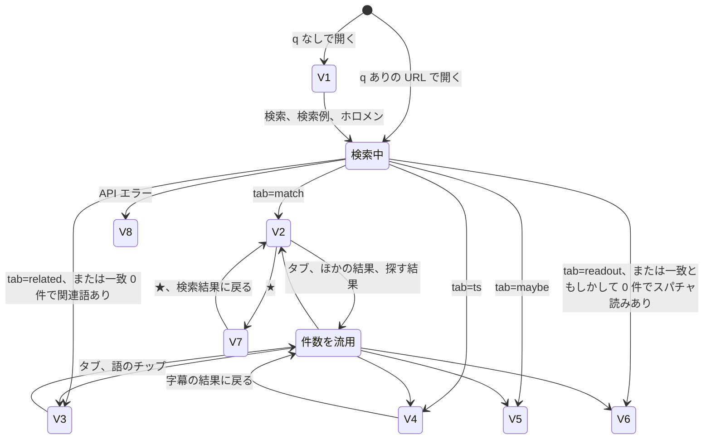

# AZKi Moment Search 画面設計書

| 項目 | 内容 |
|---|---|
| 対象 | `web/`（Vite + TypeScript + Vue 3） |
| 版 | 第 2 版（2026-11-11）。第 1 版（2026-11-02）を置き換える |
| 公開先 | 本番（β版）https://azki-moment-search.vercel.app 、プレビュー https://azki-moment-search-preview.vercel.app （保護あり） |
| 確認方法 | ソースを読み、`azkims serve`（http://127.0.0.1:8765/）のブラウザ画面で主要な動作を確認。本番は API だけ確認 |
| 関連文書 | [エンティティ一覧](01_エンティティ一覧.md) / [機能設計書](03_機能設計書.md) / [API設計書](04_API設計書.md) / [単体テスト設計書](05_単体テスト設計書.md) |

## 1. 画面一覧

画面は 1 枚の SPA です。表示の切り替えとダイアログで構成し、ページ遷移はありません。管理画面はありません。データの取得や辞書の編集は CLI（[機能設計書 3 章](03_機能設計書.md#3-cli-コマンド一覧)）で行います。

| ID | 画面名 | URL | 実装 |
|---|---|---|---|
| SCR-01 | 検索画面 | `/` | `web/src/App.vue` |
| SCR-02 | このサイトについて（ダイアログ） | なし | `web/src/components/AboutDialog.vue` |

検索画面の表示状態は次の 8 つです。

| ID | 表示 | 内容 | 出す条件 |
|---|---|---|---|
| V1 | 初期 | 説明、検索欄、検索例 | 検索語が空 |
| V2 | 一致 | 字幕の一致（tier 0〜3） | 既定 |
| V3 | 関連語 | ホロメン・ユニットの関連語を含む発言 | 検索語がホロメン・ユニットの名前のときだけタブが出る |
| V4 | タイムスタンプ | 作者のタイムスタンプ | 「条件」の「探す結果」か「ほかの結果」から選ぶ |
| V5 | もしかして | 補正候補、語の途中の読み一致、話題でない配信の関連語 | 同上 |
| V6 | スパチャ読み | 名前の読み上げの部分にだけ一致した発言 | 同上 |
| V7 | お気に入り | ブラウザに保存した結果 | ヘッダーの ★ |
| V8 | エラー | API のエラーの内容 | API が失敗したとき |

**前回からの主な変更（2026-11-10）:**

- タブは「一致」「関連語」の 2 つだけにしました。ほかの結果は「条件」で選ぶか、タブの下の「ほかの結果」から開きます。5 つ並べるとスマホで右にはみ出し、その先のタブに気づけなかったためです（霧島リンカさんの判断）。
- ヘッダーを固定の帯にし、お気に入り・配色・「このサイトについて」をアイコンにまとめました。
- 「ホロメンから探す」を追加しました。
- 並び順から「関連度順」を外しました。中身が関連度と呼べなかったためです。API と CLI には残っています。
- 補正候補の「A → B（読み距離 n）」の行をやめ、下線とルビだけで示すようにしました。
- 2026-11-11: ルビをやめ、字幕原文は「字幕原文を見る」だけで見せるようにしました。0 件のときに次に試せることを出し、お気に入りの見出しが誤って出る不具合を直しました。
- 注意書きをダイアログにまとめ、フッターは必須の 4 点だけにしました。

## 2. 画面レイアウト

### 2.1 PC 幅

2026-11-12 に作り直しました（霧島リンカさん。画面が殺風景で、PC とスマホで差が無かったため）。

- 本文の最大幅は 1180px（`--page-width`）。幅 1024px 以上では、結果（左）と「このサイトでの探し方」（右、300px。SidePanel.vue）の 2 列。
  探し方は手順ではなく、このサイトにしかない探し方（読み・関連語・作者のタイムスタンプ・直した字幕の下線）を、結果のラベルと同じ色で見せる。
- 最初の画面（検索前）は見出しの帯（`.hero`）に、説明・規模の 1 行（配信数・発言数・データ作成日）・検索欄・ホロメンのボタン（MemberChips.vue。ページを開くたびにランダムに選んだ 8 人と「すべてのホロメン」）を並べる。飾りはグラデーションと輪だけで、画像は使わない。検索した後は検索欄だけの細い帯になる。
- 見出しのキャッチコピー（「覚えている言葉で、あの瞬間を探す。」）は 2026-11-13 にやめた。作った言い回しに見えたため（霧島リンカさん）。
- 英語の小見出しと、数字のタイル 4 つ（配信数・発言数・期間・データ作成日）は、いったん作ってやめた。参考にしたファンサイトと項目・言い回しまで同じになり、真似に見えたため（2026-11-12 霧島リンカさん）。
- ホロメンの一覧（`/api/members`）は、サイトを開いた時点で 1 回だけ読む（useMembers.ts）。以前は「ホロメンから探す」を押してから読んでいて、出るまで待たされた。2026-11-12 の手元の計測では、押してから 71 人が出るまで 69ms、追加の読み込みは 0 回。
- 検索する前はタブを出さない（1 つだけ浮いて見えたため）。
- 使い方のパネルは画面より高いので、追従させない。
- 下の図は 2026-11-11 までの 1 列の配置。項目の並びは変わっていない。

```text
┌───────────────────────────────────────────────┐
│ AZKi Moment Search (β)            [★0] [☾] [?] │ A-1 ヘッダー（上に固定）
├───────────────────────────────────────────────┤
│ ( 🔍 覚えている言葉で検索            × ) [検索] │ A-2 検索フォーム
│ [☺ ホロメンから探す] [⚙ 条件•]  スペースで区切ると AND 検索 │
│ ┌ ホロメンから探す（開いたとき） ────────────┐ │ A-3
│ │ 🐻💿 そらちゃん  🤖 ロボ子さん  🌸 みこち …   │ │
│ └──────────────────────────────────────┘ │
│ ┌ 条件（開いたとき） ──────────────────────┐ │ A-4
│ │ 探す結果 (•)字幕 ( )タイムスタンプ 241 …     │ │
│ │ 並び順[新しい順▼] 配信タイトル[   ]          │ │
│ │ 開始日[   ] 終了日[   ] □完全一致            │ │
│ │ 条件を元に戻す            [この条件で検索]   │ │
│ └──────────────────────────────────────┘ │
├───────────────────────────────────────────────┤
│ [一致 3,278] [関連語 191]                       │ A-5 タブ
│ ほかの結果: タイムスタンプ 241 もしかして 886 スパチャ読み 3 │
├───────────────────────────────────────────────┤
│ タブの説明  読み: 開拓者＝カイタクシヤ          │ A-6 結果
│ (ラミたん 109)(ねぽらぼ 35)… ←関連語タブのみ   │
│ ┌ 結果カード ───────────────────────────┐ │
│ │ [原文] [AI修正] 2026-11-04 1:49:54        ☆ │ │
│ │ 開拓者さん、ありがとう（補正箇所に下線）       │ │
│ │ 字幕原文を見る  ←補正が多い発言だけ          │ │
│ │ 配信タイトル…                               │ │
│ │ [▶ 再生] [前後の発言] [YouTube ↗]            │ │
│ │ ┌ A-7 プレーヤー（16:9）┐ ┌ A-8 前後の発言 ┐ │ │
│ └──────────────────────────────────────┘ │
│               [さらに 20 件読み込む]            │
├───────────────────────────────────────────────┤
│ 非公式のファンツールです。字幕と AI の修正には誤りがあります。… │ A-9 フッター
│ このサイトについて・削除依頼・ご意見: X @rinca_rain             │
└───────────────────────────────────────────────┘
```

### 2.2 スマホ幅

幅 1024px 未満は 1 列。使い方のパネルは出さない（ページの下に並べず「このサイトについて」にまとめる決まり。2026-11-10）。見出しの帯とホロメンのボタンは出す（320px で 2 列 × 4 段と「すべてのホロメン」）。2026-11-12 に 375px と 320px ではみ出さないことを確かめた。

| 幅 | 結果 |
|---|---|
| 320px | はみ出さない（2026-11-11 に直した。ISS-13）。以前は右に約 70px はみ出していた（ヘッダーの右のボタンと、検索欄・ツールの行）。幅 360px 未満ではヘッダーの文字とボタンを小さくする |
| 375px | はみ出さない（2026-11-11 に開発セッションが手元と本番で計測。設計書を書いたセッションでは、ウィンドウが隠れていて測れなかった） |

前回（2026-11-02）も 375px で横スクロールが無いことを確認しています。

- タブは横スクロールできる 1 行です（スクロールバーは隠す）。
- 「ほかの結果」と語のチップは折り返します。
- 日付の入力欄は 2 つ並びです。

## 3. 領域ごとの項目

### A-1 ヘッダー（App.vue）

上端に固定した帯です。

| 項目 | 種類 | 動作 |
|---|---|---|
| AZKi Moment Search | リンク | `/` に戻る |
| β | ラベル | β版の印 |
| ★ と件数 | ボタン | お気に入りの表示（V7）と元の表示を切り替え |
| ☾ / ☀ | ボタン | 配色を切り替え、`azkims:theme` に保存 |
| ? | ボタン | 「このサイトについて」（SCR-02）を開く |

### A-2 検索フォーム（SearchForm.vue）

| 項目 | 種類 | 動作 |
|---|---|---|
| 検索語 | 検索欄 | スペース区切りで AND、最大 5 語、各語 2 文字以上。スマホのキーボードは「検索」ボタン |
| × | ボタン | 検索語だけを消す（検索はしない）。入力があるときだけ出る |
| 検索 | ボタン | Enter でも実行。URL を更新して検索。ホロメンの一覧が開いていれば閉じる |
| ☺ ホロメンから探す | ボタン | A-3 を開閉 |
| ⚙ 条件 | ボタン | A-4 を開閉。条件が初期値と違うと「•」が付く |
| スペースで区切ると AND 検索 | 文 | 使い方の案内 |

入力チェックは画面では行いません。空のまま検索すると V1 に戻ります。それ以外の入力エラーは API の応答を表示します。

### A-3 ホロメンから探す（MemberPicker.vue）

| 項目 | 内容 |
|---|---|
| 一覧 | `/api/members` の 71 人。推しマークの表の順（期生順） |
| 1 人分の表示 | 推しマーク（無い人は名前の頭 2 文字）と、検索に使う呼び名 |
| ツールチップ | `名前（呼び名 で検索）` |
| 押したとき | その呼び名で検索し、関連語タブ（V3）を開く |
| 読み込み | ページを開いている間、1 回だけ取得する |
| 文言 | 押すと、AZKi がよく使う呼び名で検索して、関連する話題も出します |

呼び名は、名前・呼び名のうち AZKi の字幕に最も多く出るものです（例: ときのそら → そらちゃん）。字幕に一度も出ない人は載りません。

### A-4 条件（SearchForm.vue）

| 項目 | 種類 | 初期値 | 動作 |
|---|---|---|---|
| 探す結果 | ラジオ | 字幕 | 字幕（一致・関連語）/ タイムスタンプ / もしかして / スパチャ読み。件数を併記。**選ぶとすぐ**そのタブを開く |
| 並び順 | セレクト | 新しい順 | 新しい順 / 古い順。**変えるとすぐ**検索 |
| 配信タイトル | テキスト | 空 | 「この条件で検索」で反映 |
| 開始日、終了日 | 日付 | 空 | 「この条件で検索」で反映 |
| 完全一致 | チェック | オフ | **変えるとすぐ**検索。入力全体を 1 語として、書いたとおりの表記だけで探す。3 文字以上だけ（2 文字は API が断り、その文を出す。ISS-05） |
| 条件を元に戻す | リンク | | 探す結果・並び順・配信タイトル・日付・完全一致を初期値に戻して検索。検索語はそのまま |
| この条件で検索 | ボタン | | 検索 |

### A-5 タブと「ほかの結果」（App.vue）

| 表示中 | タブの並び | タブの下 |
|---|---|---|
| 一致・関連語 | 「一致」と、検索語がタグのときは「関連語」。件数付き | 「ほかの結果:」に、件数が 1 以上のタイムスタンプ・もしかして・スパチャ読み |
| タイムスタンプ・もしかして・スパチャ読み | そのタブ 1 つと「字幕の結果に戻る」 | 「ほかの結果:」に残りのもの |
| お気に入り | 出さない | 「★ お気に入り」の見出しと「検索結果に戻る」 |

タブを切り替えても件数は数え直しません。最初の検索の件数を使い続けます（Turso の読み取りを減らすため）。

**自動の切り替え:**

| 条件 | 動作 |
|---|---|
| 関連語タブで、検索語がタグでなくなった | 一致タブへ |
| 一致タブで一致が 0 件、関連語が 1 件以上 | 関連語タブへ。履歴は積まず、今の項目を書き換える（戻るで前のページに戻る。ISS-03 は 2026-11-11 に解消） |
| 一致タブで一致ともしかしてが 0 件、スパチャ読みが 1 件以上 | スパチャ読みタブへ。同じく戻るボタンが効かない |

### A-6 結果一覧（App.vue、ResultCard.vue）

| 項目 | 表示条件 | 内容 |
|---|---|---|
| タブの説明 | 検索後 | タブごとの 1 行の説明 |
| 読み | 読みのある語があるとき | 例: 読み: 開拓者＝カイタクシヤ |
| 語の絞り込みチップ | 関連語タブ | 語と件数（多い順）。押すと絞り込み、もう一度押すと解除 |
| 検索例 | V1 | かいたくしゃ / じおげっさー / ござるさん / おにぎり。押すと検索 |
| メッセージ | 状態による | 5 章を参照 |
| さらに 20 件読み込む | 続きがあるとき | 続きを末尾に追加。件数は数え直さない |

**結果カードの項目**

| 項目 | 表示条件 | 内容 |
|---|---|---|
| ラベル | 常時 | 下表。押すと（ホバーでも）意味の説明を下に出す。もう一度押すと閉じる |
| AI修正 の印 | 表示に AI修正 を含み、tier が 2 でないとき | 「AI修正」（緑）。押すと説明を出す |
| 配信日 | 常時 | `upload_date`。無ければ「日付不明」 |
| 時刻 | 常時 | `H:MM:SS`。発言そのものの時刻 |
| ☆ / ★ | 常時 | お気に入りの追加・解除 |
| 本文 | 常時 | 補正箇所に下線（原文は下線の title）。検索語はハイライト |
| 字幕原文を見る | 補正のある発言（かなの違いだけのものを除く） | 原文を開閉 |
| 配信タイトル | 常時 | 1 行で省略 |
| ▶ 再生 / ■ 閉じる | 常時 | A-7 を開閉 |
| 前後の発言 | 常時 | A-8 を開閉 |
| YouTube ↗ | 常時 | 新しいタブで開く |

**ラベルの文言と色**

| 条件 | 文言 | 色 |
|---|---|---|
| タイムスタンプ、関連語なし | タイムスタンプ | 紫 |
| タイムスタンプ、関連語あり | 関連語: 語、語 | 紫 |
| 字幕、tier 0、1、3 | 原文 / 補正 / 読み | ピンク |
| 字幕、tier 2 | AI修正 | 緑 |
| 字幕、tier 4、5 | 候補 / 読み(部分) | アンバー |
| 字幕、tier 6 | 関連語: 語、語 | ピンク |
| 字幕、tier 7 | 関連語: 語、語 | アンバー |
| 字幕、tier 8 | スパチャ読み | アンバー |

ラベルの意味は、以前は「このサイトについて」を開かないと分からなかった。スマホにはホバーが無いので、押すと説明が出るボタンにした（2026-11-12、外部の試用での指摘）。文言は `ResultCard.vue` の `BADGE_HELP`。

**本文の補正箇所**

| 種類 | 下線 | 色 | ツールチップ |
|---|---|---|---|
| 確定補正（`confirmed`） | 実線 | ピンク | 字幕では「…」（辞書で補正） |
| 補正候補（`candidate`） | 破線 | アンバー | 字幕では「…」（補正候補） |
| AI修正（`ai`） | 点線 | 緑 | 字幕では「…」（AI修正） |

表示する本文は、AI修正 があればその文、無ければ確定補正に補正候補を当てたものです。AI修正 の文に補正候補は重ねません。

**字幕原文の見せ方**（`highlight.ts` の `hasRawToShow`）

ルビは使いません（2026-11-11）。ルビは読み（ふりがな）と受け取られ、元の字幕が誤ったふりがなに見えるためです。

| 発言 | 原文の見せ方 |
|---|---|
| 補正がある | 下線のツールチップと、「字幕原文を見る」で全体 |
| ひらがな・カタカナの違いだけの補正（ペコ → ぺこ） | 下線のツールチップだけ |

**ハイライト**

| 検索語の位置 | 動作 |
|---|---|
| 本文に表記が一致 | その部分をハイライト |
| 補正箇所の原文に一致 | 補正箇所全体をハイライト |
| 読みだけで一致 | ハイライトなし（ラベルで示す） |
| 関連語 | ハイライトの対象に加える |

### A-7 プレーヤー（YouTubePlayer.vue）

- `https://www.youtube-nocookie.com/embed/{video_id}?start={秒}&autoplay=1&rel=0` の iframe です。
- カード内に開き、同時に開けるのは 1 枚だけです。検索・タブの切り替え・別のカードの再生で閉じます。
- 開始位置は、字幕の結果では発言の 2 秒前、タイムスタンプでは書かれた時刻です。

> **注意（2026-11-02 の出来事）:** 自動再生のプレーヤーは、画面が見えていなくても再生を続けます。アプリ内ブラウザで動作確認をしたあとプレーヤーを閉じずに残したところ、利用者の PC で動画が勝手に再生されているように見えました。確認の後は必ず閉じてください。

### A-8 前後の発言（ContextPanel.vue）

- 開いたときに `/api/context` を呼び、発言の前後 30 秒を表示します。
- 各行の時刻を押すと、その発言の 2 秒前から再生します。
- 基準の発言との差が 1 秒未満の行を強調します。
- 本文は AI修正 があればその文で、「AI修正」の印を付けます。ツールチップに字幕原文を出します。
- エラー時は「前後の発言を取得できませんでした: …」、無いときは「前後 30 秒に字幕がありません」です。

### A-9 フッター（AppFooter.vue）

公開時に必ず出すと決めた 4 点と、「このサイトについて」・ソースコードへのリンクを出します。

| 項目 | 内容 |
|---|---|
| 非公式 | 非公式のファンツールです。 |
| 誤りを含む | 字幕と AI の修正には誤りがあります。 |
| 権利 | 権利は各権利者に帰属します。 |
| 削除依頼窓口 | 削除依頼・ご意見: X @rinca_rain（https://x.com/rinca_rain） |
| このサイトについて | SCR-02 を開く |
| ソースコード | ソースコード（GitHub）（https://github.com/Rinka-nation/azki-moment-search）。信頼性のためにコードを見せる（2026-11-12 霧島リンカさん）。「このサイトについて」にも同じリンク |

前回の課題 ISS-06 のうち、削除依頼窓口は実装されました。OGP（SNS 用の画像・説明）はまだありません。

### SCR-02 このサイトについて（AboutDialog.vue）

`<dialog>` のモーダルです。外側を押すか × で閉じます。

| 節 | 内容 |
|---|---|
| 導入 | 非公式のファンツールであること、β版であること |
| ご注意 | 運営会社と無関係、権利の帰属、自動字幕の誤り、AI修正 の誤り、対象外の配信、タイムスタンプの出典 |
| 結果の見方 | 下線（実線・点線・破線）、関連語、もしかして、スパチャ読み、「探す結果」 |
| 削除のご依頼・ご意見 | 作者の X の DM（@rinca_rain） |
| データの概要 | 対象配信数、期間、発言数、タイムスタンプ数、データ作成日（`/api/stats`。取れなければ出さない） |

## 4. 画面の状態遷移



| 操作 | 件数 | URL |
|---|---|---|
| 検索、並び順・完全一致の変更、条件を元に戻す、ホロメン | 数え直す | 更新 |
| 戻る・進む | 覚えている結果なら検索しない。無ければ前の結果を消して数え直す | 読み直し |
| タブ、ほかの結果、探す結果、語のチップ | **数えない**（最初の値を使う） | 更新 |
| さらに読み込む | 数えない | 変えない |
| お気に入り | 検索しない | 変えない |

そのほかの決まりです。

- 戻る・進む: 最近の 20 件の結果（さらに読み込んだ分も）を、条件ごとに画面の中に覚えておき、API を呼ばずにすぐ出す。再読み込みで消える。以前は戻った直後に、直前の検索の結果が残って見えていた（2026-11-11、外部の試用での指摘。案 A）

- 検索の連打では、最新の検索の結果だけを使います（`requestSeq`）。
- 検索・タブの切り替えでは、開いている再生を閉じます。

## 5. メッセージ

| 状況 | 文言 |
|---|---|
| 検索前 | かな・カタカナでも、漢字や英語の言葉を探せます。 |
| 検索中 | 検索中… |
| 0 件 | 見つかりませんでした。 |
| お気に入りが空 | お気に入りはまだありません。結果の ☆ で追加できます。 |
| お気に入りの説明 | このブラウザに保存したお気に入りです。 |
| 追加読み込み中 | 読み込み中… |
| ホロメンの一覧の読み込み | 読み込み中… / 読み込めませんでした: … |
| API のエラー | API の `error` の内容をそのまま表示 |

タブの説明文は `App.vue` の `tabs` にあります。

| タブ | 説明文 |
|---|---|
| 一致 | 下線は直した箇所。元の字幕は上の小さな文字か「字幕原文を見る」で見られます |
| 関連語 | 呼び名・用語・曲名など、その人に関係する言葉です |
| タイムスタンプ | 作者が投稿したタイムスタンプコメントです |
| もしかして | 読みが近いだけのものも含みます |
| スパチャ読み | 名前の読み上げの部分にだけ一致した発言です |

## 6. URL パラメータ

検索条件は URL に残ります。URL を保存・共有すると同じ検索を再現できます（`useSearchState.ts`）。

| パラメータ | 省略時 | URL に出す条件 | 不正な値 |
|---|---|---|---|
| `q` | 空 | 値があるとき | |
| `tab` | `match` | `match` 以外のとき | `match` |
| `word` | 空 | 値があるとき | |
| `title` | 空 | 値があるとき | |
| `from`、`to` | 空 | 値があるとき | 画面は検査しない。API が `YYYY-MM-DD` 以外を 400 にし、その文を画面に出す |
| `sort` | `new` | `old` のとき | `new`。古い URL の `relevance` も `new` に読み替える |
| `exact` | オフ | オンのとき `exact=1` | |

お気に入りの表示、開いているパネル（ホロメン・条件）は URL に残りません。

## 7. デザイン

| 項目 | ライト | ダーク |
|---|---|---|
| 切り替え | 標準 | `html[data-theme="dark"]` |
| 背景 | `#fff9fc` | `#1a1015` |
| 面 | `#ffffff` | `#24161d` |
| 文字 | `#2b1b24` | `#f6e9ef` |
| アクセント | `#d11c76` | `#f4348b` |
| もしかして系 | `#9a6a00` | `#f2c45a` |
| タイムスタンプ系 | `#5a3fa6` | `#b9a3ff` |
| AI修正 | `#1d6f64` | `#7fd6c8` |

- AZKi のイメージカラー `#d11c76`、`#f4348b` を基調にします。
- 配色は `public/theme.js` が描画前に当て、ちらつきを防ぎます。CSP で inline の script を許さないので、`index.html` に直接は書きません（2026-11-11 に変更）。
- 色の定義は `web/src/style.css` にあります。

## 8. 検索エンジン対策とアクセシビリティ

β版は「URL を知っている人だけ」に見せるため、検索エンジンに載せない設定を 3 か所に入れています。アクセス制限ではありません。

| 場所 | 設定 | 本番での確認 |
|---|---|---|
| `index.html` | `<meta name="robots" content="noindex, nofollow">` | コードで確認 |
| `vercel.json` | 全パス（`/api` を含む）に `X-Robots-Tag: noindex, nofollow` | 2026-11-11 に応答ヘッダーで確認。このときは `/api` に付いていなかった。規則の順番を直し、プレビューで `/api` にも付くことを確認。本番は次の publish から |
| `robots.txt` | `Disallow: /` | 2026-11-11 に取得して確認 |

| 項目 | 実装 |
|---|---|
| 言語 | `<html lang="ja">` |
| ラベル | 検索語に `sr-only` のラベル、アイコンボタンに `aria-label` |
| 状態 | タブに `aria-current`、★・チップ・お気に入りに `aria-pressed`、開閉に `aria-expanded` |
| 更新の通知 | 結果領域に `aria-live="polite"` |
| ランドマーク | `role="search"`、`nav aria-label` |
| ダイアログ | `<dialog>`、`aria-labelledby` |

## 9. 確認結果

ローカル（`azkims serve`）のブラウザで 2026-11-11 に確認しました。動画は再生していません。

| 項目 | 結果 |
|---|---|
| 検索（開拓者） | 一致 3,278。ほかの結果にタイムスタンプ 241、もしかして 886、スパチャ読み 3 |
| 結果カードの操作 | ▶ 再生 / 前後の発言 / YouTube ↗ |
| 検索語の × | 入力が消える（前回の ISS-02 は解消） |
| ホロメンから探す | 71 人。先頭は 🐻💿 そらちゃん |
| 条件の「探す結果」 | 字幕 / タイムスタンプ 241 / もしかして 886 / スパチャ読み 3 |
| このサイトについて | 開閉できる |
| 一致 0 件 → 関連語タブ（桃鈴ねね） | 切り替わる。1 回戻ると前のページに戻る（2026-11-11 に確認。ISS-03 は解消） |
| 320px 幅 | はみ出さない（2026-11-11 に手元と本番で確認。ISS-13 は解消） |

確認していないこと:

- ダーク配色の全画面
- お気に入りの実機操作（単体テストは通過）
- 映像の再生そのもの
- 本番の画面（API とヘッダーだけ確認）

## 10. 画面の課題

一覧と詳細は [機能設計書 9 章](03_機能設計書.md#9-課題一覧) にまとめています。

| ID | 内容 | 状態 |
|---|---|---|
| ISS-02 | 「条件をクリア」が動作しない | **解消**（× と「条件を元に戻す」に作り直し） |
| ISS-03 | 自動切り替えの後、戻るボタンが効かない | **解消**（2026-11-11。スパチャ読みへの自動切り替えも） |
| ISS-06 | 削除依頼窓口と OGP が無い | 窓口は**解消**。OGP は未実装 |
| ISS-13 | 320px 幅で右にはみ出す | **解消**（2026-11-11） |
