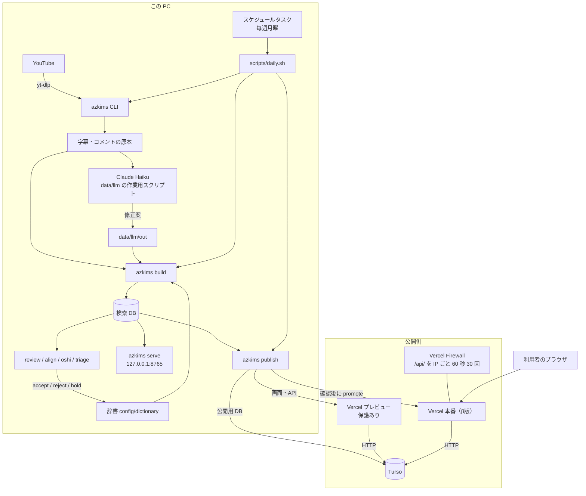
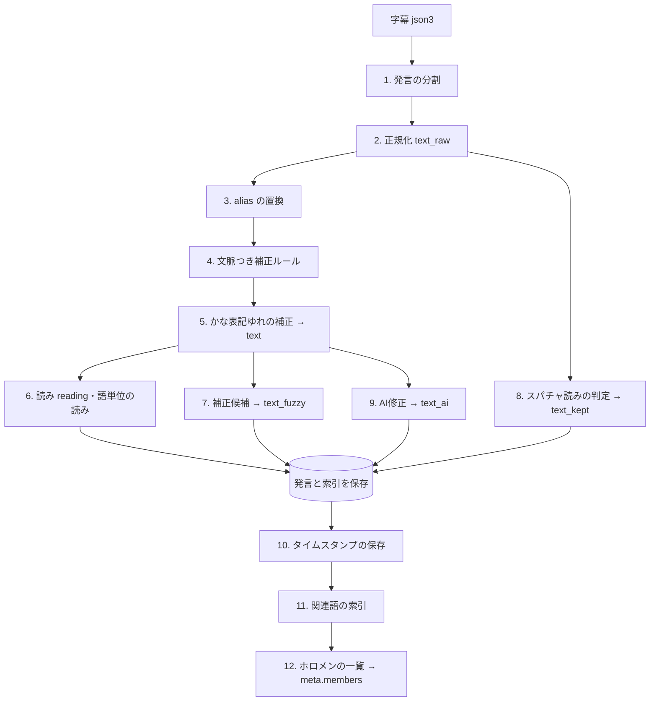
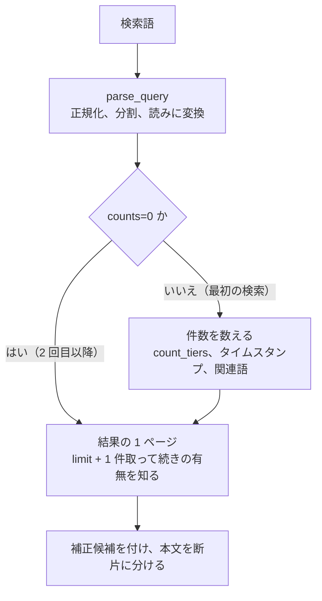
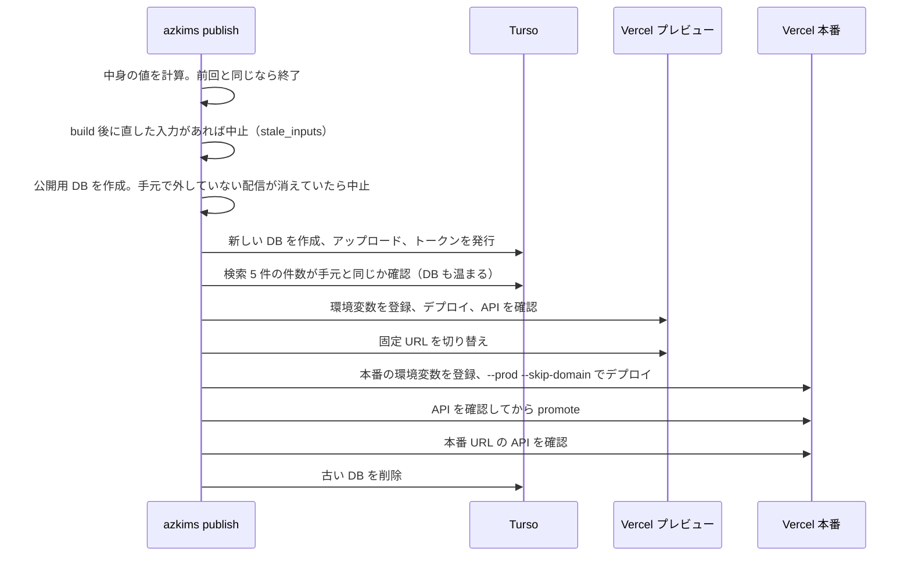

# AZKi Moment Search 機能設計書

| 項目 | 内容 |
|---|---|
| 対象 | `AZKiMomentSearch` のコミット `e55a5a4`（2026-11-11。リモートは無く、この PC の中だけにある） |
| 版 | 第 2 版（2026-11-11）。第 1 版（2026-11-02）を置き換える。同日、9 章の課題の対応後の状態に合わせて更新 |
| 根拠 | 実コード。`DESIGN.md` などと食い違う場合はコードを正とし、8 章に差分を記載 |
| 関連文書 | [エンティティ一覧](01_エンティティ一覧.md) / [画面設計書](02_画面設計書.md) / [API設計書](04_API設計書.md) / [単体テスト設計書](05_単体テスト設計書.md) |

## 1. システムの概要

AZKi の配信で「何か言っていた気がする」発言を、覚えている言葉で検索し、その瞬間から再生できるようにする非公式ファンツールです。

YouTube の自動字幕は固有名詞をよく間違えます（AZKi → あずき、ホロメン → ホロ面）。そこで、**字幕を書き換えて終わりにせず、補正の段階を層として残し、どの層で一致したかを検索結果の信頼度として見せる**のが中心の考え方です。層は次の 4 つです。

| 層 | 作り方 | 確からしさ |
|---|---|---|
| 字幕原文 | YouTube の自動字幕そのまま | 字幕の誤りを含む |
| 確定補正 | 人が採用した辞書の別表記などで置換 | 高い |
| AI修正 | LLM（Claude Haiku）が文脈から直した文。別の層に持ち、印を付ける | 中程度。誤りがある |
| 補正候補 | 読みが近い辞書語を当てただけ。本文は書き換えない | 低い（「もしかして」） |

### 1.1 現在の状態

| 項目 | 値 | 確認 |
|---|---|---|
| 公開 | **β版を公開中**（2026-11-10〜）。URL を知っている人だけ。検索エンジンには載せない | 本番 API で確認 |
| 本番 | https://azki-moment-search.vercel.app （保護なし） | 2026-11-11 に API が 200 を返すことを確認 |
| プレビュー | https://azki-moment-search-preview.vercel.app （Vercel のログインが要る） | 未ログインで 302 になることを確認 |
| 更新 | 毎週月曜の朝、この PC のスケジュールタスクが `scripts/daily.sh` を実行し、本番まで自動で更新 | タスクが有効なことを確認。次回は 2026-11-16 |
| 検索対象の配信 | 606 本（うち字幕あり 589 本） | DB で確認 |
| 発言 | 694,767 件 | DB で確認 |
| AI修正 のある発言 | 47,844 件（6.9%） | DB で確認 |
| タイムスタンプ | 49,353 行（249 配信） | DB で確認 |
| 公開用 DB | 507 MB | ファイルで確認 |
| 精度の作業 | 2026-11-09 に止めた。以後は機能の追加と検索費用の削減 | メモリの記録 |

### 1.2 規模と費用の前提

| 前提 | 内容 | 崩れたら |
|---|---|---|
| 費用 | 無料枠に収める。上限を超えたら課金ではなく停止する構成 | サイトが止まる（課金はされない） |
| 最終規模 | 開発メモは「配信 622 本以上」。ライブ除外の後の対象は 606 本 | 数字の見直しが要る（[エンティティ一覧 3.1](01_エンティティ一覧.md#31-規模)） |
| 増加 | 週 2〜4 本、1 年で発言 +12〜24 万件の見込み | 公開用 DB の容量。Turso の 5 GB に対しては余裕がある |
| 利用者 | β版の評価者。人数は不明 | 読み取りの枠（7.5） |

### 1.3 全体構成



| 層 | 技術 | 備考 |
|---|---|---|
| データ取得 | Python 3.11+、yt-dlp | 字幕とメタデータのみ。音声・動画は取得しない |
| 形態素解析 | SudachiPy（`sudachidict_core`） | 読みの生成、語の分割 |
| AI修正 | Claude Haiku（Pro プランの Claude Code を `-p` で実行） | build のたびには呼ばない。結果を `data/llm` に保存 |
| DB | SQLite + FTS5（trigram、unicode61） | 手元はファイル、公開側は Turso |
| 検索 API | Python 標準ライブラリの HTTP サーバー | 手元も Vercel も同じコード |
| 画面 | Vue 3、TypeScript、Vite | 実行時の依存は vue のみ |
| 公開 | Vercel（Hobby。Python 関数、静的配信、Firewall）+ Turso | |

## 2. 機能一覧

| ID | 機能 | 使う人 | 手段 | 実装 |
|---|---|---|---|---|
| F-01 | 配信一覧の取得 | 運用者 | `azkims sync` | `pipeline.sync` |
| F-02 | 除外判定 | 運用者 | sync、fetch の中で実行 | `filters.py` |
| F-03 | 字幕の取得 | 運用者 | `azkims fetch` | `pipeline.fetch` |
| F-04 | タイムスタンプコメントの取得 | 運用者 | `azkims fetch-comments` | `pipeline.fetch_comments` |
| F-05 | 発言の分割 | 運用者 | build の中 | `captions.py` |
| F-06 | 固有名詞の補正 | 運用者 | build の中 | `pipeline.analyze` |
| F-07 | 読みの生成 | 運用者 | build の中 | `reading.py` |
| F-08 | スパチャ読みの判定 | 運用者 | build の中 | `readout.py` |
| F-09 | AI修正 の適用 | 運用者 | build の中 | `llmfix.py` |
| F-10 | 関連語の索引 | 運用者 | build の中 | `related.build_index` |
| F-11 | 検索 DB の構築 | 運用者 | `azkims build` | `pipeline.build` |
| F-12 | 補正候補のレビュー | 運用者 | `review`、`accept`、`reject`、`hold` | `review.py`、`dictionary.py` |
| F-13 | 未知語の発見 | 運用者 | `discover` | `review.collect_unknown` |
| F-14 | タイムスタンプとの照合 | 運用者 | `align` | `align.py` |
| F-15 | 候補の自動仕分け | 運用者 | `triage` | `triage.py` |
| F-16 | 推しマークによる名前補正 | 運用者 | `oshi` | `oshi.py` |
| F-17 | 発言の検索 | 閲覧者 | 画面、CLI | `search.py` |
| F-18 | 関連語検索 | 閲覧者 | 画面 | `search.py`、`related.py` |
| F-19 | タイムスタンプ検索 | 閲覧者 | 画面、CLI | `search.search_timestamps` |
| F-20 | ホロメンから探す | 閲覧者 | 画面 | `/api/members`、`related.member_list` |
| F-21 | 秒数付き再生、前後の発言 | 閲覧者 | 画面 | `YouTubePlayer.vue`、`/api/context` |
| F-22 | お気に入り、配色 | 閲覧者 | 画面 | `useFavorites.ts`、`useTheme.ts` |
| F-23 | ローカルの検索サーバー | 運用者 | `azkims serve` | `server.py` |
| F-24 | 配備物の組み立て | 運用者 | `azkims bundle-vercel` | `deploy.py` |
| F-25 | DB の入れ替えと公開（プレビュー → 本番） | 運用者 | `azkims publish` | `publish.py` |
| F-26 | 公開先の動作確認 | 運用者 | `azkims smoke` | `cli.cmd_smoke` |
| F-27 | 週 1 回の自動実行 | スケジュールタスク | `scripts/daily.sh` | |
| F-28 | 状況の確認 | 運用者 | `azkims stats` | `cli.cmd_stats` |

## 3. CLI コマンド一覧

全コマンド共通で `--config <パス>` を指定できます。省略時は `config/config.toml`、無ければ `config/config.example.toml` です。

### 3.1 データの取得と構築

| コマンド | 引数 | 動作 | 外部通信 |
|---|---|---|---|
| `sync` | `--limit N` | 配信一覧を取得し、除外判定をやり直す | YouTube |
| `fetch` | `--limit N`、`--retry-errors`、`--ids ID…` | 未取得の対象配信の字幕を取得 | YouTube |
| `fetch-comments` | `--limit N`、`--retry-errors` | タイムスタンプコメントを取得 | YouTube |
| `build` | なし | 原本・辞書・AI修正 から検索 DB を全件作り直す | なし |

### 3.2 検索と確認

| コマンド | 引数 | 動作 |
|---|---|---|
| `search 語…` | `--title`、`--from`、`--to`、`--sort new/old/relevance`、`--tab both/match/maybe/all/ts`、`--limit`、`--offset`、`--surface-only` | CLI で検索。関連語、完全一致、スパチャ読みには対応していない。件数の内訳は tier の名前で表示する（ISS-12 は解消） |
| `stats` | なし | 配信数、取得状況、発言数などを表示 |
| `serve` | `--port`（既定 8765） | 検索 API と画面を起動（127.0.0.1 のみ。Host ヘッダーが手元の名前でなければ 403） |

### 3.3 辞書の育成

| コマンド | 引数 | 動作 | 出力 |
|---|---|---|---|
| `review` | なし | 補正候補を集計 | `output/review_candidates.md` |
| `discover` | `--streams N`、`--min-count N`（既定 3） | 辞書に無い語を集計 | `output/unknown_terms.md` |
| `align` | なし | タイムスタンプと字幕を照合 | `output/timestamp_alignment.md` |
| `triage` | `--apply`、`--aggressive` | 候補をルールで仕分け | `output/triage.md`。`--apply` で `accepted.toml` に追記 |
| `oshi` | `--apply` | 推しマークからホロメン名の候補を探す | `output/oshi_candidates.md`。`--apply` で追記 |
| `accept 表記 語` | `--scope global/title` | 候補を採用 | `accepted.toml` に追記 |
| `reject 表記 語` | なし | 候補を却下 | 同上 |
| `hold 表記 語` | なし | 候補を保留 | 同上 |
| `drop-source 名前` | | `source` が一致する項目をまとめて削除 | `accepted.toml` を更新 |

### 3.4 公開

| コマンド | 引数 | 動作 | 外部への影響 |
|---|---|---|---|
| `bundle-vercel` | `--turso`、`--turso-export` | `deploy/` に配備物を組み立てる | なし |
| `publish` | `--force` | DB を入れ替え、プレビューと**本番**を切り替える | **Turso と Vercel の本番を変更** |
| `smoke URL` | | 公開先の API を確認 | 読み取りのみ |

### 3.5 AI修正 の作成（CLI の外）

AI修正 の修正案を作るスクリプトは `azkims` の CLI ではなく、`tools/llm/` にあります（`run.py`、横展開の `prop/`、指示文の `INSTRUCTIONS.md` など。2026-11-11 に `data/llm/` から移して git 管理にした。ISS-14）。

- 入力と出力（約 136MB、字幕の本文を含む）は、今までどおり git 管理外の `data/llm/` に置きます。各スクリプトは自分の場所から `data/llm/` を探します。
- 新しい配信の修正案は手で作ります。`daily.sh` は LLM を呼びません（方針が決まるまで）。
- 本書はこのスクリプトの中身を読んでいません。設計は DESIGN.md 5.11 とメモリの記録によります。

### 3.6 運用の流れ

```text
（毎週月曜、自動）
sync → fetch（1 件で試す → 50 件）→ fetch-comments → build
     → stats / triage（案だけ）/ align → publish（プレビュー → 本番）

（手作業）
review / discover / align / triage / oshi → 辞書の修正、accept / reject / hold
新しい配信の AI修正（tools/llm で作り、data/llm に出力）
→ build → publish
```

## 4. データの取得

### 4.1 F-01 配信一覧の取得

1. yt-dlp で `https://www.youtube.com/@AZKi/streams` の一覧を flat で取得します。
2. `streams` に upsert します。`availability`、`live_status` は値があるときだけ上書きします。
3. 全配信の除外判定をやり直し、`meta.included_only` を消します（`reclassify`）。

### 4.2 F-02 除外判定

判定順は [エンティティ一覧 9 章](01_エンティティ一覧.md#9-コード値) のとおりです。除外は「歌枠」に加えて、2026-11-09 からライブ本番（3D LIVE、チラ見せ枠、周年・生誕ライブのパターンと手動の 6 本）も対象です。

判定を実行するのは `sync` と `fetch` だけです。設定の `exclude_video_ids` を変えただけでは反映されません。

### 4.3 F-03 字幕の取得

1. 対象を選びます。条件は次のとおりで、`list_order` 順に `limit`（既定 50）件までです。
   - `excluded_reason IS NULL`
   - 未取得（`--retry-errors` なら `error` も）
   - 配信日が不明か、今日から `min_age_days`（3 日）以上前
2. 1 配信ずつ直列に処理します。2 件目からは 20 秒 + 0〜15 秒待ちます。
3. メタデータを取得し、自動字幕（json3）を保存します。
4. 取得して初めて配信日が分かり、それが新しすぎたら、未取得に戻して次回に回します。

| 状況 | 動作 |
|---|---|
| 字幕が無い | `no_captions` を記録して続行 |
| `ja` が機械翻訳（URL に `tlang`） | 取得せず `no_captions` |
| 取得失敗 | `error` を記録して続行 |
| ブロックの兆候（`confirm you're not a bot`、HTTP 429、Too Many Requests） | ただちに中断 |
| 5 件連続でエラー | 中断 |

音声と映像はダウンロードしません（`skip_download`）。並列化もしません。

### 4.4 F-04 タイムスタンプコメントの取得

1. 対象を選びます。字幕取得済みで、配信日が 3 日以上前で、`since`（2025-02-01）以降の配信のうち、未取得か `editing` のものです。
2. 上位 60 件の親コメントとその返信を取得します。
3. `author_ids`（霧島リンカさん）のコメントだけを保存します。他の視聴者のコメントは保存しません。
4. 本文に（編集中）があれば `editing` にし、次回も取り直します。今の版は検索に使います。

### 4.5 タイムスタンプの解析

```text
3:36  開始                     → 216 秒
　　今日は鉄道の日！            → 補足行（直前の時刻、is_note=1）
└5:11  車両基地が400以上？      → 311 秒
└33:30  駅発見！「ぴぴぴぴぴ」  → 2010 秒、quotes に「ぴぴぴぴぴ」
└13:24  :_guess:               → スタンプだけの行は捨てる
```

| 規則 | 内容 |
|---|---|
| 行頭の記号 | `└├┗┣・-–—>＞` と空白を除去 |
| 時刻 | `H:MM:SS` または `M:SS` |
| 最初の時刻より前の行 | 見出しとして捨てる |
| 時刻の無い行 | 直前の時刻の補足 |
| メンバースタンプ `:_xxx:` | 除去 |
| 2 文字未満の行 | 捨てる |
| 「」内（2 文字以上） | `quotes` に入れる |

本文と返信をまとめて解析し、時刻順に並べ直します。

## 5. 検索 DB の構築（F-05〜F-11）

### 5.1 処理の流れ

`azkims build` は 1 つのトランザクションで全件を作り直します。結果は「字幕の原本 + 辞書 + 設定 + 推しマーク + コメントの原本 + AI修正 の修正案」だけで決まります。

対象は検索対象かつ字幕取得済みの配信だけです。**除外した配信の発言は作りません**（前回の課題 ISS-01 の修正）。配信は新しい順に処理し、発言の `id` もその順に振ります。



最後に `meta` の `built_at`、`utterance_order`、`included_only`、`dictionary_terms` を書きます。build のログには、AI修正 の修正案のうち使った件数と、捨てた理由ごとの件数が出ます。

### 5.2 発言の分割

字幕の全文字に時刻を振り、次の位置で区切ります。

| 条件 | 値 |
|---|---|
| 文末記号 | `。?!？！` |
| 無音 | 2000ms 超 |
| 音声タグ | `[音楽]`、`[笑い]` など。タグは本文から除去 |
| 長さ | 60 文字以上で読点の位置、80 文字で強制 |

その後、細切れの発言を直前の発言につなげます。直前との間が 4 秒以内、合計 80 文字以内で、この発言が 8 文字未満か、直前が文末記号で終わっていなければ結合します。2 文字未満の発言は捨てます。

### 5.3 確定補正（`text`）

| 種類 | 内容 | 条件 |
|---|---|---|
| alias の置換 | 辞書の別表記を最長一致で canonical に置換 | `scope` による |
| 文脈つき補正ルール | 下表の判定で「補正」のもの | ルールによる |
| かな表記ゆれの補正 | ひらがな・カタカナだけの表記で、読みが辞書語と完全に同じものを直す | 読み 4 文字以上、読みが他の語と重ならない、普通の 1 語でない、`kana_fix = false` でない |

**文脈つき補正ルール**（`rules.py`）は、`かけん`（かなけん の崩れ、または「水かけんの？」）のように単純に置換できない表記を判定します。

| 順 | 条件 | 結果 |
|---|---|---|
| 1 | 後ろが `after`、または前が `before` | 補正 |
| 2 | 前が `not_before`、または後ろが `not_after` | 補正しない |
| 3 | 配信の話題が `topic` | 補正 |
| 4 | それ以外 | 補正候補（`otherwise = "keep"` なら候補にもしない） |

**話題（文脈）**

| 文脈 | 中身 | 使い道 |
|---|---|---|
| `context`（配信全体） | タイトルに出る語 + タイムスタンプの推しマーク・名前から分かる人 + `game:{id}` | `scope = title`、`topic_only`、ゲームの語、候補の判定 |
| `near`（発言の近く） | 発言の 90 秒前〜20 秒後のタイムスタンプの話題 | `scope = near` |

「ホロライブ」「AZKi」はほぼ全タイトルに付くので、文脈から除きます。

### 5.4 補正候補（`text_fuzzy`）

`review.FuzzyMatcher` が探します。本文の `text` には混ぜず、「もしかして」に出します。

1. 1〜5 トークンの窓を作ります。助詞などで始まる・終わる窓、句読点をまたぐ窓は対象外です。
2. バイグラムの転置索引で辞書語を絞り、読みの編集距離を求めます。
3. 距離 ÷ 語の読みの長さが 0.34 以下なら候補です。
4. 〇〇衣装・〇〇ちゃん は、語尾を除いた〇〇の部分で比べます（`name_part_close`、2026-11-03）。語尾が同じだけで近く見える候補（じいちゃん → すいちゃん）を出さないためです。
5. 既知の表記、却下済みの組は除きます。
6. 普通の言葉の並びで、音の距離が 1 を超えるものは除きます。
7. 重なる候補は、距離の比率が小さいもの、次に長いものを優先します。
8. `screen` で絞ります。別のゲームの語は除き、`topic_only` の語は話題の配信だけ、読み 5 文字以下の語は距離 1 以上ならタイトルにある配信だけ残します。

**音の距離（`sound_distance`）** は、濁点・半濁点の違いと拗音の小書きの違いを 0.5、それ以外を 1 と数える編集距離です。自動仕分けで「音が近い」候補だけを通すために使います。

### 5.5 読み

| 処理 | 内容 |
|---|---|
| 辞書優先 | 辞書語は辞書の読みを使う。Sudachi は 星街 を ホシガイ と読むため |
| 辞書の外 | Sudachi の読み |
| 畳み込み（`fold_reading`） | ひらがな → カタカナ、英字は大文字。長音・促音・中黒・記号を除去。小書きを大書きに。ヴ行 → バ行。ヂ → ジ、ヅ → ズ、ヲ → オ |

語単位の読みは、長単位（C）と短単位（A）の両方で 1〜4 トークンの連なりを登録します。これで「てつどう」が「鉄道博物館」の語の境界で一致します。

### 5.6 F-08 スパチャ読みの判定（`readout.py`）

スパチャ読みの「親方さん、マコールさん、宮本さん、ありがとう」のような名前の並びに一致すると、話題の検索の邪魔になります。そこで名前の連続だけを切り出し、検索では別のタブに分けます。**表示と原文は変えません。**

| 規則 | 内容 |
|---|---|
| 名前 | 「さん」で終わる 15 文字以下の区切り。辞書にある語（ホロメンの名前など）は名前として扱わない |
| 名前でない語 | 皆さん、みなさん、みんなさん |
| 間をつなぐ語 | え、あー、まあ、はい、ありがとう、サンキュー など |
| 連続 | 異なる名前が 3 つ以上続く部分 |
| 句読点のない発言 | 「さん」が 5 回以上で、読点が 1 つ以下なら、「さん」で区切って判定 |
| 結果 | 連続を除いた残りを `text_kept`、`reading_kept` に入れる。全体が読み上げなら空文字 |

検索では、検索語が `text_kept` に無いとき tier 8（スパチャ読み）にします。索引は変えず tier の判定を足すだけなので、読む行数は増えません。

### 5.7 F-09 AI修正（`llmfix.py`）

辞書では直せない一般語の聞き間違い（博多の一覧 → 一蘭）を、LLM が文脈から直した修正案を当てます。

**方針（2026-11-04 霧島リンカさんの判断）:** 「誤補正は未補正より悪い」の原則は、誤補正で文がさらに意味の通らないものになるのを避けるためです。意味の通らない文を、文意がほぼ同じで正しい文に直す LLM の修正は、この原則より優先します。ただし辞書の補正とは別の層に持ち、印を付けて表示します。

修正案の読み込み（`load_fixes`）:

| 規則 | 内容 |
|---|---|
| 対応づけ | (video_id, start_ms) で発言に対応させる |
| 番号のずれ | 示された範囲に `wrong` が無ければ、前後 3 発言から探し直す |
| 捨てるもの | JSON でない、番号か `wrong` が無い、`fix` が無いか `wrong` と同じ、`wrong` が 1 つの発言に収まらない |
| 捨てるもの（2026-11-09〜） | ホロメンの呼び名を別の人の呼び名に変える修正（んなたん → かなたん） |
| 名前の表記 | LLM が書き足したホロメンの名前を公式の表記にそろえる（ペコラ → ぺこら、ふぶき → フブキ）。理由にフルネームがあるか、直後に敬称が付くときだけ |
| 横展開 | `prop/out/` の修正案を、ほかの修正の後に当てる |

当てるとき（`apply_fixes`）:

- `wrong` が今の `text` に無い修正案は当てません。修正案の作成後に、辞書の補正で直った・変わった発言です（辞書を優先）。
- スパチャ読みの連続がある発言には当てません。
- AI修正 の文の読みも `reading` と語単位の読みに加え、読みでも探せるようにします。

精度は検証されていません。8 配信の試験（104 件）で、霧島リンカさんが見て明らかな誤りが 6 件ありました。全体の約 4.8 万件は未確認です。誤りを人手で 1 件ずつ直すことはせず、直すときは辞書で行う方針です（2026-11-09）。

### 5.8 F-10 関連語の索引（`related.build_index`）

字幕の `text` と `text_raw`、タイムスタンプの本文、配信タイトルから関連語を探します。スパチャ読みの連続の部分は探しません。

```text
strong の語                      → 常に confident = 1
weak の語・話題の配信            → confident = 1
weak の語・話題でない配信        → confident = 0（もしかしてタブの末尾）
タイムスタンプの推しマーク        → そのホロメンの confident = 1（2026-11-10〜）
```

話題の配信は、タイトルかタイムスタンプに名前・呼び名がある配信か、字幕に名前・呼び名が 3 発言以上ある配信です。ユニットは、メンバーが話題の配信も話題とします。語の探索では長い表記を優先し、カタカナ語や英単語の途中では一致させません。

### 5.9 ホロメンの一覧（`related.member_list`）

画面の「ホロメンから探す」の一覧を build で作り、`meta.members` に保存します。`/api/members` はこの 1 行を読むだけです。

| 項目 | 決め方 |
|---|---|
| 対象 | 関連語のタグのうちホロメン（ユニットを除く）。字幕に名前・呼び名が 1 回も出ない人も載せる（2026-11-13 から。それまでは載せなかった） |
| 並び | 推しマークの表の順（期生順）。推しマークの無い人はその後ろ |
| 呼び名 | 名前・呼び名のうち、字幕に最も多く出るもの。字幕に出ない人は呼び名の最初のもの（無ければ名前） |

## 6. 辞書の育成（F-12〜F-16）

運用の中心は「候補を見る → 採否を決める → build し直す」の繰り返しです。ただし 2026-11-09 に精度の作業を止めており、今は辞書への追加を手で行う程度です。

| 判断 | 効果 |
|---|---|
| accept | alias になり、次の build から確定補正（tier 1） |
| hold | 本文は字幕のまま、候補として「もしかして」に残る。レビュー一覧には出ない |
| reject | 候補からも外す |

### 6.1 F-15 候補の自動仕分け（`triage.classify`）

上から順に判定します。

| 順 | 条件 | 判定 |
|---|---|---|
| 1 | Sudachi の辞書にある 1 語 | reject |
| 2 | 動詞・助動詞で終わる | hold |
| 3 | 音の距離が 0.5 を超える | hold |
| 4 | 普通の句で、1 回しか出ず、タイトルにもタイムスタンプにも裏付けが無い | hold |
| 5 | `--aggressive` の場合: 読み距離 2 以上は hold、それ以外は accept | |
| 6 | 読み距離 2 以上 | hold |
| 7 | 不自然な分かれ方、または辞書に無い語を含む | accept（距離 1 以上でタイトルの配信のみなら title） |
| 8 | 普通の句で、読みが完全一致 | accept |
| 9 | 普通の句で、タイムスタンプの裏付けあり | accept |
| 10 | 普通の句で、その語のタイトルの配信に出る | accept（title） |
| 11 | それ以外 | hold |

`--apply` を付けたときだけ `accepted.toml` に書き込みます。週 1 回の自動実行では案（`output/triage.md`）を作るだけです。

### 6.2 F-16 推しマークによる名前補正

タイムスタンプには、ホロメンの話が出た時刻に推しマーク（🌸 = さくらみこ など）が書かれています。その時刻の -20〜+90 秒の字幕で、話題の人の名前と愛称だけを、通常より緩い条件で探します。

| 条件 | 内容 |
|---|---|
| 距離の上限 | 読み 3 文字以下は 0、6 文字以下は 1、それ以上は 2 |
| 敬称で終わる愛称 | 候補も同じ語尾で終わり、名前部分の距離が 1 以下 |
| 除外 | 語形違い、数字を含むもの、「っ」「の」で終わる切れ端、別の語と読みが同じもの、複数人の候補になる表記 |
| 紛らわしい相手がいる表記 | `scope = near` で登録 |
| それ以外 | `scope = title` で登録 |

### 6.3 F-14 タイムスタンプとの照合

タイムスタンプを正解として、その時刻の -20〜+60 秒の字幕と突き合わせます（`azkims align`）。

- 辞書語の拾えている率
- 裏付けのある補正候補（距離比 0.4 まで）
- 「」の照合（表記一致 / 読み一致 / 読みが近い / 見つからず）

## 7. 検索と公開

### 7.1 F-17 検索の処理



**語の解析**

| 規則 | 内容 |
|---|---|
| 正規化 | NFKC、空白の整理 |
| 区切り | 半角スペース。ただし空白を含む辞書語（`from A to Z`）は 1 語 |
| 上限・下限 | 5 語まで、各語 2 文字以上、全体で 100 文字まで（正規化した後。2026-11-14、ISS-18） |
| 読み | 辞書優先。読みが 2 文字未満なら読みでは探さない |
| 完全一致 | 入力全体を 1 語とし、読みを使わない。関連語検索もしない |

**索引の選び方**（`_matching_sql`）

| 語の条件 | 引き方 | 全件走査 |
|---|---|---|
| 全語が表記か読みで 3 文字以上あり、読み 2 文字の語が無い | `utterances_fts MATCH`。関連度に bm25 | なし |
| 上記以外で、全語を索引で引ける | サブクエリの `IN`。読み 2 文字の語は語単位の索引を前方一致 | なし |
| 表記が 2 文字で読みが無い（完全一致の 2 文字、記号だけ） | 2026-11-11 から `parse_query` が 400 で断る（`LIKE` の分岐は残るが通る入力は無い） | なし（以前はあり。ISS-05） |

**読む行数を減らす工夫**（2026-11-09〜10。DESIGN.md 10.5）

| 工夫 | 内容 |
|---|---|
| 件数は最初の検索だけ | さらに読み込む・タブ・語のチップでは `counts=0` で件数を数えない（検索語・条件が表示中の結果と違うときだけ、画面が数え直す。ISS-17） |
| 件数を数えずに続きを知る | `limit + 1` 件取る。続きは `cursor` で渡す |
| 新しい順は索引の順に読む | 発言の `id` が新しい順なので、一致タブを新しい順に見るときは `utterances_fts.rowid` で並べて `LIMIT` する。FTS5 が 20 件で止まる |
| 件数で配信と結合しない | `meta.included_only` があり、配信名・日付の絞り込みが無いとき |

DESIGN.md の実測（589 配信、Turso の `rows_read` の合計）では、最初の検索で 開拓者 19,937 行、配信 15,142 行、ありがとう 92,064 行、さらに読み込むは 開拓者 3,333 行です。工夫の前（11-06）の約半分〜4 割です。本書ではこの値を測り直していません。

**並び順**

| タブ | 指定 | 並び |
|---|---|---|
| 一致 | new | 配信日の新しい順・動画・時刻（索引の順に読む） |
| 一致 | old | 配信日の古い順・動画・時刻（全部読んで並べ替え） |
| 一致 | relevance（API と CLI のみ） | tier → 候補の距離 → 関連度 |
| もしかして、スパチャ読み | すべて | tier → 候補の距離 → 指定の並び |
| タイムスタンプ | new / old | tier → 配信日（指定の向き）→ 時刻（ISS-09 は解消） |
| 関連語 | new / old | 配信日、動画、時刻 |

### 7.2 F-18 関連語検索

1. 検索語のどれかがタグの名前・呼び名なら関連語検索です。先頭に見つかった語を使います。
2. 関連語タブは、検索した呼び名そのものの発言も含めます（一致タブと重なる。2026-11-10 霧島リンカさん）。
3. もしかしてタブの末尾に足す weak の分（`confident = 0`）だけは、一致タブとの重なりを除きます。
4. 他の語があれば、その語も含む発言に絞ります。
5. タイムスタンプでは `confident = 1` の一致を、タイムスタンプ検索の結果の後ろに続けます。推しマークの行も入ります。

AZKi 本人はタグにしていません。全配信が本人のためです。

### 7.3 F-25 DB の入れ替えと公開

`azkims publish` が全件入れ替えを 1 コマンドで行います。`build` は全件作り直しで発言番号が変わるため、差分更新はしません。**本番（β版）の更新も含みます**（2026-11-10 霧島リンカさんの決定）。



| 状況 | 動作 |
|---|---|
| 中身の値が同じ | 何もしない。`--force` で実行 |
| build の後に辞書・推しマーク・設定・AI修正・字幕・コメントを直した、sync の後に build していない、`web/src` が `web/dist` より新しい | 中止（`stale_inputs`） |
| 前回公開した配信が消えていて、手元の DB で外した（`excluded_reason` がある）ものだけ | 通す（削除依頼・ライブの除外） |
| 前回公開した配信が、理由なく消えている | 中止。Turso に触らない。`--force` でも通らない |
| Turso の確認で `TursoError` | 5 秒おきに最大 4 回試す（入れ替え直後の DB は最初の検索が遅い） |
| プレビューの確認で失敗 | 新しい DB を消す。固定 URL は前のデプロイのまま |
| 本番の切り替え前に失敗 | 本番は前の DB のまま。その DB は消さない |
| 本番の切り替え後の確認で失敗 | 前の DB は消さずに残す。次の publish が消す |
| デプロイ先の API の確認 | 失敗したら 5 秒おきに最大 4 回試す（切り替え直後の 1 回目が失敗したため） |

中身の値（`content_fingerprint`）の材料:

| 含む |
|---|
| 対象の動画 ID の一覧 |
| `ts_entries` の件数、`data/comments/*.json` |
| `config/dictionary` 以下の全 TOML |
| `config/oshi_marks.toml`、`config/config.toml`、`config/config.example.toml`（2026-11-11 追加） |
| `data/llm/out`、`data/llm/prop/out` |
| `src/azkims`、`vercel`、`web/dist` |

`web/src`（画面の元のコード）は含みませんが、`web/dist` より新しければ `stale_inputs` が止めます。

### 7.4 F-27 週 1 回の自動実行（`scripts/daily.sh`）

この PC の Claude デスクトップアプリのスケジュールタスク「AZKi Moment Search：字幕の週 1 回取得」が、毎週月曜の朝にこのスクリプトだけを実行します。クラウドに移さないのは、データが手元にしか無く、YouTube がデータセンターの IP を疑うこと、DB を削除できるトークンを PC の外に出さないためです（2026-11-02 の判断）。

| 順 | 処理 | 失敗したとき |
|---|---|---|
| 1 | `sync` | ログに残して続行 |
| 2 | `fetch --limit 1 --retry-errors`（試しに 1 件） | ブロックされていれば取得を飛ばす |
| 3 | `fetch --limit 50` | ブロックされていれば以降の取得を飛ばす |
| 4 | `fetch-comments --limit 60` | ログに残す |
| 5 | `build` | **中止**（終了コード 1） |
| 6 | `stats`、`triage`（案だけ）、`align` | 続行 |
| 7 | `publish` | 終了コードを返す |

- 辞書は変えません。`--force`、`--prod` は付けません（本番の更新は `publish` の中で行う）。
- ログは `output/daily_log.txt` などに出ます。
- 前回の実行は 2026-11-09（月）、次回は 2026-11-16（月）の予定です（スケジュールタスクの一覧で確認）。
- スケジュールタスクの説明文と指示文は、2026-11-11 に「本番も publish が切り替える」内容に直しました（実行するコマンドは同じ）。

### 7.5 公開側の構成と無料枠

| 項目 | 内容 |
|---|---|
| 関数 | `/api/*` を `api/index.py` の 1 つの関数に集約。最大実行時間 15 秒。東京（`hnd1`）で動かす（`vercel.json` の `regions`。Turso の DB と同じ東京。2026-11-14 まではワシントンの `iad1` で、検索 1 回に 1.3〜2.3 秒かかっていた） |
| DB | `TURSO_URL`、`TURSO_TOKEN` で Turso を HTTP で読む |
| 秘密情報 | 公開側に置くのは読み取り専用トークンだけ |
| 保護 | Deployment Protection の Standard（プレビューだけ保護、本番は公開） |
| 回数制限 | Vercel Firewall で `/api/` を IP ごと 60 秒 30 回、超えたら 429 |
| キャッシュ | 成功した応答を CDN に 1 日（`s-maxage=86400, stale-while-revalidate=86400`）。失敗の応答は `no-store`。キャッシュはデプロイごとに分かれる（開発セッションが読んだ Vercel の公式文書による）。2026-11-11 に本番で、新しい語の 1 回目が MISS、2 回目が HIT（ISS-10 は解消。以前は全応答が `no-store` で効いていなかった） |
| 検索エンジン | noindex（meta、`X-Robots-Tag`、robots.txt） |
| セキュリティ用ヘッダー | `vercel.json` の最初の規則で全パス（`/api` を含む）に付ける。CSP は自分のドメインのものだけを読み込み、埋め込みは `www.youtube-nocookie.com` だけ。他のサイトへの埋め込みは断る（`frame-ancestors 'none'`、`X-Frame-Options: DENY`） |
| Python の依存 | `vercel/requirements.txt` で版を固定（`==`）。週 1 回の publish は確認なしで本番まで切り替えるため。手元の版を上げたら合わせて直す（UT-113 が食い違いを見る） |

Firewall と保護の設定は Vercel の画面にあり、リポジトリにはありません。本書では、本番が未ログインで開けることと、プレビューが 302 になることだけを確かめました。回数制限そのものは試していません。

**無料枠**

| サービス | 制限 | 超えたとき | 出典 |
|---|---|---|---|
| Turso | 容量 5 GB、読み取り月 5 億行、書き込み月 1,000 万行、DB 100 個 | 課金ではなく停止 | DESIGN.md（2026-10 時点）。本書では再確認していない |
| Vercel Hobby | 関数の呼び出し月 100 万回、Active CPU 月 4 時間、転送量 100 GB | デプロイが止められることがある | DESIGN.md（2026-11-10 に公式で確認との記載）。本書では再確認していない |
| Vercel Hobby（デプロイの保存） | 10 GB。1 デプロイ約 84 MB | 古いデプロイがすぐ消され、デプロイが止められることがある（課金なし） | 2026-11-13 に公式の変更履歴で確認。publish は数を表示するだけ。30 個を超えたら、承認を得て手で片付ける |

**読み取りの見積もり**（見込み。実測の値は DESIGN.md の 589 配信の記録）

| 使われ方 | 1 回の行数 | 月 5 億行で |
|---|---|---|
| 「開拓者」程度の最初の検索 | 約 2 万行 | 約 2.5 万回（1 日約 830 回） |
| 「ありがとう」程度の最初の検索 | 約 9.2 万行 | 約 5,400 回（1 日約 180 回） |
| さらに読み込む | 約 3,300 行 | 約 15 万回 |
| 回数制限いっぱいで 2 万行の検索を続ける | 60 秒で 60 万行 | **約 14 時間で使い切る** |
| 回数制限いっぱいで 9.2 万行の検索を続ける | 60 秒で 276 万行 | **約 3 時間で使い切る** |

- 本書の作成時は CDN のキャッシュが効いておらず、同じ語の検索もすべて数えていました。2026-11-11 に直し、同じ URL の 2 回目以降はデプロイごとに 1 日、Turso を読みません（ISS-10）。回数制限いっぱいの悪用は別々の語を送れば避けられるので、上の表の見積もりは変わりません
- `rows_read` が Turso の無料枠の数え方と同じかは確認されていません（DESIGN.md の記載）。
- 悪用で使い切られる危険は、利用者が受け入れた危険です（2026-11-10）。使い切るとサイトが止まり、課金はありません。
- Active CPU の検索 1 回あたりの値は測っていません。本番の応答時間は 1.0〜4.8 秒でした（2026-11-11、6 回）。大半は Turso の待ち時間と見られますが、確かめていません。

### 7.6 設定値

`config/config.example.toml` の値です。

| セクション | キー | 値 | 意味 |
|---|---|---|---|
| `channel` | `url` | `https://www.youtube.com/@AZKi/streams` | 対象チャンネル |
| `fetch` | `caption_lang` | `ja` | 字幕の言語 |
| `fetch` | `sleep_seconds` | 20.0 | 配信ごとの待ち時間。6 秒では約 110 件連続で HTTP 429 になった |
| `fetch` | `sleep_jitter` | 15.0 | 待ち時間の揺らぎ |
| `fetch` | `max_videos_per_run` | 50 | 1 回の処理件数 |
| `fetch` | `min_age_days` | 3 | 配信日からこの日数がたった配信だけ取る |
| `filter` | `singing_title_patterns` | 10 パターン | 歌枠・ライブの判定 |
| `filter` | `exclude_video_ids` | 6 本 | 手動で除外（ライブ本番） |
| `filter` | `include_video_ids` | 空 | 必ず含める |
| `segment` | `max_chars`、`gap_ms` | 60、2000 | 発言の区切り |
| `timestamps` | `author_ids` | 霧島リンカさんのチャンネル ID | 取り込む投稿者 |
| `timestamps` | `since` | 2025-02-01 | 取得の開始日 |
| `timestamps` | `max_parents` | 60 | 探す親コメント数 |

コード内の主な定数:

| 定数 | 値 | 場所 |
|---|---|---|
| 検索語の下限・上限 | 2 文字、5 語、全体で 100 文字 | `search.py`（`MAX_QUERY_CHARS`） |
| 配信タイトルの絞り込みの上限 | 100 文字 | `server.MAX_TITLE_CHARS` |
| publish が使う Vercel CLI | `vercel@65.16.0` | `publish.VERCEL_CLI` |
| 再生の開始位置 | 発言の 2 秒前 | `search.PLAYBACK_LEAD_SEC` |
| 補正候補の距離比 | 0.34 | `review.MAX_DISTANCE_RATIO` |
| 自動採用の音の距離 | 0.5 | `triage.MAX_SOUND_DISTANCE` |
| スパチャ読みの名前の数 | 3（句読点なしは「さん」5 回） | `readout.py` |
| AI修正 の番号のずれ | 前後 3 発言 | `llmfix.NEARBY` |
| 関連語の話題の回数 | 3 | `related.TOPIC_MIN` |
| API の最大取得件数 | 50 | `server.MAX_LIMIT` |
| 前後の発言の範囲 | 前後 30 秒 | `server.py` |
| Turso のタイムアウト | API 1 回の合計で 12 秒（通信失敗時は残り時間で 1 回やり直し。2026-11-11、ISS-08） | `turso.REQUEST_BUDGET_SECONDS` |
| 関数の最大実行時間 | 15 秒 | `vercel/vercel.json` |
| 関数のリージョン | `hnd1`（東京） | `vercel/vercel.json` の `regions` |
| publish の確認のやり直し | 5 秒おきに最大 4 回 | `publish.py` |

## 8. 文書・コメントとコードの差分

文書やコメントがコードより古い箇所です。本書はコードを正としています。

| 箇所 | 記載 | 実際 |
|---|---|---|
| `DESIGN.md` 10.4、10.5 | API は CDN で 1 時間キャッシュ | 効いていない。関数の `no-store` が勝っている（2026-11-11 に確認）。**直した**（キャッシュを効かせ、記載も 1 日に更新） |
| `vercel/vercel.json` | `/api/*` に `s-maxage=3600` | 同上。**直した**（関数の応答で決めるので vercel.json から消した） |
| `publish.py` の先頭 | 本番（--prod）にはデプロイしない | 本番もデプロイして promote する。**直した** |
| スケジュールタスクの説明文 | プレビュー反映 | 本番も更新する。**直した**（説明文と指示文。`daily.sh` の先頭のコメントも） |
| `server.py`、`api.ts` の先頭 | 公開時は Cloudflare Workers + D1 | Vercel の Python 関数 + Turso。**直した** |
| `DESIGN.md` 8、10.1 | フェーズ 2「いまここ」、Cloudflare | β版を公開中、Vercel + Turso。**直した** |
| `DESIGN.md` 5.3 | 距離比 0.25 以下 | 0.34（5.9 に変更の記載あり）。**直した** |
| `DESIGN.md` 5A | 2025-02 以降 | 取得は 2025-02-01 から、実データは 2025-03-17 以降。**直した** |
| `DESIGN.md` 6 | `comment_fetch` は ok / none / error | `editing` もある。**直した** |
| `search.search_timestamps` の説明 | tier 0、2、4 | 実際は 0、3、5（AI修正 を 2 に入れたときの振り直しが反映されていない）。**直した** |
| `db.py` の索引のコメント | 2 文字は LIKE で全走査 | 読みがあれば語単位の索引で引く。**直した**（索引で引けない語は断る、も追記） |
| `cli.py` の `oshi` のレポート | 推しマークの範囲は -20〜+60 秒 | -20〜+90 秒。**直した** |
| `README.md` | 検索結果は 2 区分、Vercel はプレビューのみ | 5 区分（一致・関連語・タイムスタンプ・もしかして・スパチャ読み）、本番も公開。**直した** |
| 開発メモ | 今の 333 本で動くことは根拠にしない、最終規模 622 本以上 | 今は 589 本取得済み、対象は 606 本。**直した**（霧島リンカさんの確認で 606 本以上、今の 589 本） |

## 9. 課題一覧

本書の作成中に確認した問題です。本書の作成時点では修正していません。**2026-11-11 に別のセッションで対応し、状態の列を更新しました**（各節の末尾の「対応」）。前回（第 1 版）の課題の状態も記載します。

| ID | 重要度 | 内容 | 状態（2026-11-11 対応後） | 確認 |
|---|---|---|---|---|
| ISS-01 | 低 | 除外した配信の発言が公開 DB に残る | **解消**。`/api/context` が配信を見る。publish は sync の後に build していない DB を公開しない | テスト（NT-004）、本番の API |
| ISS-02 | - | 「条件をクリア」が動作しない | **解消** | 画面で確認 |
| ISS-03 | 中 | 自動切り替えの後、戻るボタンが効かない | **解消**（自動切り替えは `replaceState`） | テスト（NT-007、NT-008）、画面で「桃鈴ねね」 |
| ISS-04 | 中 | `publish` が build 前の DB を公開できる、変更を見落とす、除外で止まる | **解消** | テスト（NT-005、NT-006 ほか） |
| ISS-05 | 中 | 完全一致の 2 文字で全件走査になる | **解消**（400 で断る。読みの無い 2 文字の記号も） | Turso で実測、テスト（NT-009）、本番の API |
| ISS-06 | 低 | 削除依頼窓口と OGP が無い | 窓口は**解消**。OGP は未実装（今回の対象外） | 画面で確認 |
| ISS-07 | **高**（公開中） | 500 エラーが例外の内容を返す | **解消**（定型文。内容はログだけ） | テスト（NT-001） |
| ISS-08 | 中 | Turso の待ち時間が関数の上限を超え得る | **解消**（API 1 回の合計で 12 秒まで）。本番での時間切れは再現していない | テスト |
| ISS-09 | 低 | タイムスタンプタブで並び順が効かない | **解消** | テスト（NT-010）、本番の API |
| ISS-10 | **高**（公開中） | API に CDN のキャッシュが効いていない | **解消**（2 回目が `HIT`） | 本番で確認、テスト（NT-002） |
| ISS-11 | 低 | `from`、`to` の形式を検査しない | **解消**（400） | テスト（NT-011）、本番の API |
| ISS-12 | 低 | CLI の件数の表示が tier の振り直しに追いついていない | **解消** | テスト（NT-012）、実行して確認 |
| ISS-13 | 中 | 320px 幅で画面が右にはみ出す | **解消** | 画面で計測（320px・375px）。テストは無い（jsdom は配置を計算しない） |
| ISS-14 | 中 | AI修正 を作るスクリプトと大量の変更が git に無い | **解消**。スクリプトと指示文を `tools/llm/` に移し、変更をコミットした（霧島リンカさんの判断。リモートは無いので push はしていない） | ファイル、git log |
| ISS-15 | 低 | 横展開の修正案に壊れた行があると build が止まる | **解消** | テスト（NT-014） |

### 9.1 2026-11-14 のコード全体の見直し

霧島リンカさんの依頼でサイト全体を調べたときに見つけた課題です。ISS-16〜18、20、21、24 は同じ日に直し、本番に出しました（ISS-24 は ISS-21 を確かめる途中で見つけたもの）。ISS-19、22、23 は霧島リンカさんの判断待ちです。

| ID | 重要度 | 内容 | 状態（2026-11-14） | 確認 |
|---|---|---|---|---|
| ISS-16 | **高**（公開中） | 検索の関数がワシントン（iad1。Vercel の既定）で動き、東京の Turso と SQL 1 本ごとに往復していた（キャッシュに無い検索 1 回 1.3〜2.3 秒） | **解消**（`vercel.json` の `regions: ["hnd1"]`。本番で 0.12〜0.25 秒） | 本番の `vercel inspect`（`[hnd1]`）と x-vercel-id（`hnd1::hnd1`）、件数が手元と一致、テスト（UT-128） |
| ISS-17 | 中 | 検索を押さずに書き換えた語・条件のままタブや「探す結果」を切り替えると、件数が前の検索のまま。さらに読み込むは書きかけの語で続きを取る | **解消**（表示中の結果の条件を覚え、違えば数え直す。続きは表示中の条件で取る） | 手元の画面で再現と解消を確認。本番の画面でも、書きかけの語でタブ・書きかけの配信タイトルで探す結果・書きかけのままさらに読み込む、の 3 つを確認。テスト（NT-015） |
| ISS-18 | 中 | 検索語と配信タイトルの長さに上限が無い（手元でも 1,500 文字で 1 回 1.6 秒、3,000 文字で 7 秒） | **解消**（100 文字まで。超えたら 400。入力欄にも maxlength） | テスト（NT-016）、手元の API（1,500 文字は 0.04 秒で 400）、本番の API（101 文字の検索語・完全一致・配信タイトルは 400、ちょうど 100 文字は 200）と入力欄の maxlength |
| ISS-19 | 低 | 残している「1 つ前の本番」のデプロイが使う DB を publish が消すので、戻し先にならない | 未対応（判断待ち） | 1 つ前の本番の `/api/stats` が 503 |
| ISS-20 | 低 | publish の Vercel CLI の版が固定されておらず、実行のたびに npm の最新版を取る | **解消**（`publish.VERCEL_CLI`） | テスト（UT-129）、固定した版でデプロイの一覧を取得し、publish で本番まで切り替え |
| ISS-21 | 低 | build が遅い。辞書の語の読み（`Term.folded`）と配信タイトルの話題（`title_context`）を使うたびに計算し直していた | **解消**（1 回だけ計算する。同じ配信 40 本で 268 秒 → 90 秒。全件は約 24 分） | 全件の build で、全部の表の中身が変更前の DB と一致 |
| ISS-22 | 低 | 使っていない Turso の DB（azkims-test 325MB、azkims-setup）が残っている | 未対応（判断待ち。消すと戻せない） | Turso の API で一覧と使用量 |
| ISS-24 | 低 | build の結果が実行のたびにわずかに変わる（AGENTS.md の「決定的」に反する）。重なった同点の補正候補の選び方と、関連語の表に行を入れる順が、Python のハッシュの種で変わっていた。全件の build で発言 1 件（あず1 → あずきち の候補）が違った | **解消**（同点は前にあるもの、同じ位置なら辞書に先に書いた語。関連語は並べてから入れる） | 配信 40 本をハッシュの種 3 通りで build して全部の表が一致、テスト（UT-130、UT-131） |
| ISS-23 | 低 | よく出る語（なんか 53,379 件 等）の検索 1 回の読み取りが多い。1 回約 22 万行の見込みで、回数制限の上限で送り続けると 1 つの IP で月 5 億行を約 75 分で使い切る | 未対応（DESIGN.md 10.4 で「受け入れた危険」とした件の見直し。判断待ち） | 手元の一致数と、一致 1 件あたり約 4 行という記録からの見込み。Turso では未測定 |

### ISS-01 除外した配信の発言（解消）

build は検索対象の配信だけを処理するようになり、公開用 DB にも除外配信の発言は 0 件です。

残るのは次の場合だけです。`/api/context` は配信の表を見ないので、除外の設定を変えて `sync` した後、`build` をせずに公開すると、除外配信の発言が残ります。ただしこの場合は配信数が減るため、`publish` の配信数の確認で止まります。

**対応（2026-11-11）:** `/api/context` が配信の表を見る（配信の行を 1 回引くだけ。実測 19 行）。publish は、sync の後に build していない DB（`included_only` が無い）を公開しない

### ISS-03 自動切り替えの後、戻るボタンが効かない

`App.vue` の自動切り替えは `selectTab` の中で `history.pushState` を実行します。戻ると `tab` なしの URL に戻り、再び条件に当たって、また履歴を積みます。

**再現:** 「桃鈴ねね」（一致 0 件、関連語 133 件）を検索して 2 回戻っても、`?q=桃鈴ねね&tab=related` のままでした。スパチャ読みへの自動切り替えも同じ作りです。

**対応案:** 自動切り替えでは `history.replaceState` を使います。

**対応（2026-11-11）:** 自動切り替え（関連語・一致・スパチャ読み）は `selectTab(tab, true)` で `history.replaceState` にした（`useSearchState.pushUrl(replace)`）。手での切り替えは今までどおり履歴を積む。画面で「桃鈴ねね」を検索して 1 回戻ると、前のページに戻ることを確かめた。

### ISS-04 `publish` の確認の漏れ（解消）

中身の値にコード・画面・コメント・AI修正 が加わり、前回の見落としの大半は解消しました。残りは次のとおりです。

| 残り | 影響 |
|---|---|
| `publish` は `build` を実行しない | 手で辞書を直して `build` を忘れると、古い DB が公開される。自動実行では `daily.sh` が先に `build` するので起きない |
| `oshi_marks.toml`、`config.toml` が中身の値に無い | 推しマークだけ直したときは検知しない |
| `web/src` を直しても `npm run build` しないと反映されない | 中身の値は `web/dist` で見ているので、古い画面のまま「中身が同じ」になる |
| 配信数が減ると止まり、`--force` でも通らない | **削除依頼で配信を外すと、公開が止まる。** 2026-11-09 のライブ除外では、利用者の了承のもと `turso_active.json` の値を手で 589 に書き換えて通した |

**対応案:** 配信数の確認は、除外した配信の分を差し引いて判定するか、明示の指定で通せるようにします。

**対応（2026-11-11）:**

- 配信数: 公開した配信の一覧（`stream_ids`）を `turso_active.json` に残し、消えた配信が手元の DB で外した（`excluded_reason` がある）ものだけなら通す。理由の無い減少は今までどおり止める。一覧の無い古い記録では本数だけを比べる。`--force` で通す案は、誤った DB を通す道を増やすので採らなかった
- 中身の値に `oshi_marks.toml`、`config.toml`、`config.example.toml` を加えた
- build のし忘れ: publish の最初に `stale_inputs` を見る。辞書・推しマーク・設定・AI修正・字幕・コメントが `built_at` より新しい、sync の後に build していない（ISS-01）、`web/src` が `web/dist` より新しい、のどれかなら止める。週 1 回の実行は build の直後なので止まらない

### ISS-05 完全一致の 2 文字で全件走査になる

完全一致は読みを使わないので、2 文字の語は `LIKE` で全件を読みます。画面の「完全一致」から誰でも実行できます。手元の実測では「配信」の完全一致が 1.06 秒で、通常の検索（0.01〜0.09 秒）の 10 倍以上でした。発言 69 万件とタイムスタンプ 5 万件を、件数と結果でそれぞれ 2 回読むので、1 回で約 150 万行以上を読む見込みです（実測ではない）。無料枠の月 5 億行で約 330 回分です。

**対応案:** 完全一致の 2 文字を拒否するか、語単位の索引を使います。

**対応（2026-11-11）:** 公開中の今は残さないことにした。Turso で実測すると、完全一致の「配信」は 1 回 **1,457,138 行・約 15 秒**（関数の上限と同じ）で、通常の「配信」は 15,146 行だった。IP ごと毎分 30 回の制限の中でも、1 人で数分のうちに月の無料枠（5 億行）を使い切れる。完全一致は 3 文字以上だけにし、2 文字は 400（「2 文字は完全一致を外すと探せます」）で断る。調べると、読みの無い 2 文字の記号（`!?` など）も同じ全件走査になったので、これも断る。2 文字の英字（ab、xy）は読みが付き、索引で引ける（実測 192〜5,095 行）。語単位の索引を完全一致に使う案は、語の途中の一致を落として「書いたとおりの表記を探す」の意味が変わるので採らなかった

### ISS-07 500 エラーが例外の内容を返す

`server.py` は、想定外の例外の型とメッセージをそのまま応答に入れます。β版は外部に公開しているので、内部の情報（SQL の断片やファイルのパスなど）が見える可能性があります。ログだけに記録し、応答は定型文にするべきです。

**対応（2026-11-11）:** 500 の本文は定型文（「検索中にエラーが起きました。時間をおいて試してください」）にし、例外の型と traceback は関数のログ（標準出力）にだけ出す。

### ISS-08 Turso の待ち時間が関数の上限を超え得る

Turso の接続は 1 回 12 秒で、通信失敗時は 1 回やり直すので最大 24 秒です。最初の検索は SQL を 4〜10 回実行します（2026-11-11 にローカルで実測。関連語のタグがあると多い）。一方、関数の最大実行時間は 15 秒です。DESIGN.md には、DB の入れ替え直後に 25 秒で 503 になった記録があります。本番で時間切れになったとき画面にどう見えるかは確認していません。

**対応（2026-11-11）:** Turso を待つ時間を、API 1 回（接続 1 つ）の合計で 12 秒までにした（`turso.REQUEST_BUDGET_SECONDS`）。各 SQL は残り時間だけ待ち、残りが 0.5 秒を切ったら送らずに `TursoError`（503 の定型文）にする。関数の上限 15 秒で Vercel に打ち切られる前に、画面にエラーの文が出る。本番で時間切れは再現していないので、打ち切りの見え方は本番では確かめていない

### ISS-09 タイムスタンプタブで並び順が効かない

タイムスタンプの検索は `sort` を使いません。画面で「古い順」を選んでも、タイムスタンプの結果は新しい順のままです。不正な値も 400 になりません。

**対応（2026-11-11）:** タイムスタンプの検索（本体と関連語の分）も `sort` を使う（古い順のときだけ配信日の古い順）。不正な値は API の入口で 400。本番で `tab=ts&sort=old` の先頭が 2025-03-17 になることを確かめた。読む行数は新しい順と同じ（開拓者 18,114 行、ぺこちゃん 21,246 行）

### ISS-10 API に CDN のキャッシュが効いていない

`server.py` はすべての API 応答に `Cache-Control: no-store` を付けます。`vercel.json` の `/api/*` の `s-maxage=3600` は効いていません。

**確認（2026-11-11、本番）:** 同じ検索を 2 回送り、どちらも `x-vercel-cache: MISS`、`cache-control: no-store` でした。`/api/stats`、`/api/members` も同じです。

**影響:** 同じ語の検索も毎回 Turso を読みます。DESIGN.md の読み取りの見積もりは「同じ語は CDN が 1 時間キャッシュする」を前提にしていたので、その分が成り立ちません。

**対応案:** 公開用の関数では `no-store` を付けないようにします。データは publish のたびに入れ替わるので、1 時間程度のキャッシュで古い結果が残る期間は、最長でも週 1 回の更新の直後の 1 時間です。ただし変更後は、キャッシュが実際に効くかを本番で確かめる必要があります。

**対応（2026-11-11）:** `no-store` に意図した理由の記録は無かった（ローカル用の第 1 段階のハンドラが、そのまま公開側でも使われていた）。公開側（`vercel/api/index.py`）だけ、成功した応答に `public, s-maxage=86400, stale-while-revalidate=86400` を付け、失敗（400・500・503）とローカルの serve は `no-store` のままにした。Vercel の公式の説明では、CDN のキャッシュはデプロイの URL ごとに分かれ、publish は毎回新しいデプロイを作るので、DB の入れ替え後に古い結果は返らない。そのため 1 時間より長い 1 日にした。`vercel.json` の `/api/*` のヘッダーは関数の値に上書きされるので消した。本番で、まだ送っていない検索を 3 回送り、MISS → HIT → HIT を確かめた。設計書を書いたセッションでも、別の新しい語で MISS（5.1 秒）→ HIT（0.06 秒）、失敗の応答（400）が `no-store` であることを確かめた。キャッシュから返した応答を Firewall の回数制限が数えるかは確かめていない

### ISS-12 CLI の件数の表示がずれている

`cli.cmd_search` の見出しは、AI修正 を tier 2 に入れる前の番号のままです。

**再現:** `azkims search ホロドリ` は「一致 172 件（原文 16 / 補正 122 / **読み 34**）」と表示します。実際の内訳は 原文 16 / 補正 122 / **AI修正 34** / 読み 0 です。tier 3（読み）は「もしかして」の件数に数えられます。

**対応（2026-11-11）:** 見出しの内訳を `search.TABS` と `TIER_LABELS` から作るようにした（`cli.tab_header`）。`azkims search ホロドリ` は「一致 172 件（原文 16 / 補正 122 / AI修正 34 / 読み 0）」と出る

### ISS-13 320px 幅で画面が右にはみ出す

幅 320px（スクロールバーを除く 305px）で、ページの幅が 373px になりました。はみ出すのはヘッダーの右のボタン群（右端 347px）と、検索欄・ツールの行（右端 372px）です。375px の端末で起きるかは確認できていません。

**対応（2026-11-11）:** 原因は 2 つ。検索欄の行は、グリッドの列が中身の幅（入力欄の既定の幅、約 208px）より狭くなれなかった（`grid-template-columns: minmax(0, 1fr)` で解消）。ヘッダーはロゴ 210px + ボタン 122px が収まらなかった（幅 360px 未満で文字とボタンを小さくした）。320px と 375px で `scrollWidth` が画面の幅と同じことを、手元と本番で確かめた

### ISS-14 AI修正 の作成手順と大量の変更が git に無い

| 対象 | 状態 |
|---|---|
| AI修正 を作るスクリプト（`data/llm/run.py`、横展開の `prop/` など） | `data/` の下で git 管理外 |
| 最新コミット以降の変更（39 ファイル、約 6,000 行）と新しいファイル 20 個以上 | 未コミット |

この PC の故障や誤操作で、AI修正 を作り直す手順と、2 週間分の開発の履歴を失う可能性があります。

**対応（2026-11-11）:** 霧島リンカさんの判断で、スクリプト 14 本と指示文（`INSTRUCTIONS.md`）を `tools/llm/` に移した（計 76KB）。入力・出力（約 136MB、字幕の本文を含む）は `data/llm/` のまま。各スクリプトは自分の場所から `data/llm/` を探すように書き換え、`check.py` を新しい場所から実行して同じ出力を読めることを確かめた。それまでの変更と合わせてコミットした。リポジトリにリモートが無いので、PC の故障に備えるには別の場所への複製（push など）がまだ要る

### ISS-15 横展開の修正案に壊れた行があると build が止まる

`llmfix.load_fixes` は、通常の修正案の壊れた JSON は捨てて続行します。一方、横展開（`prop/out`）の行は例外を捕まえないので、1 行でも壊れていると build 全体が失敗します。自動実行では build の失敗で公開まで止まります。

**対応（2026-11-11）:** 横展開の行も、JSON でない行・`wrong`／`fix`／`start_ms` が無い行を捨てて続け、理由を数える。今のデータでは捨てる行は 0（2,175 行すべて使う）なので、build の結果は変わらない

### ISS-11 `from`、`to` の形式を検査しない

日付は文字列で比較します。形式が違っても 200 で返り、意図しない結果になります。画面は日付の入力欄なので、URL を直接書き換えた場合だけ起きます。

**対応（2026-11-11）:** `from`、`to` は `YYYY-MM-DD` だけを受け付け、それ以外は 400
