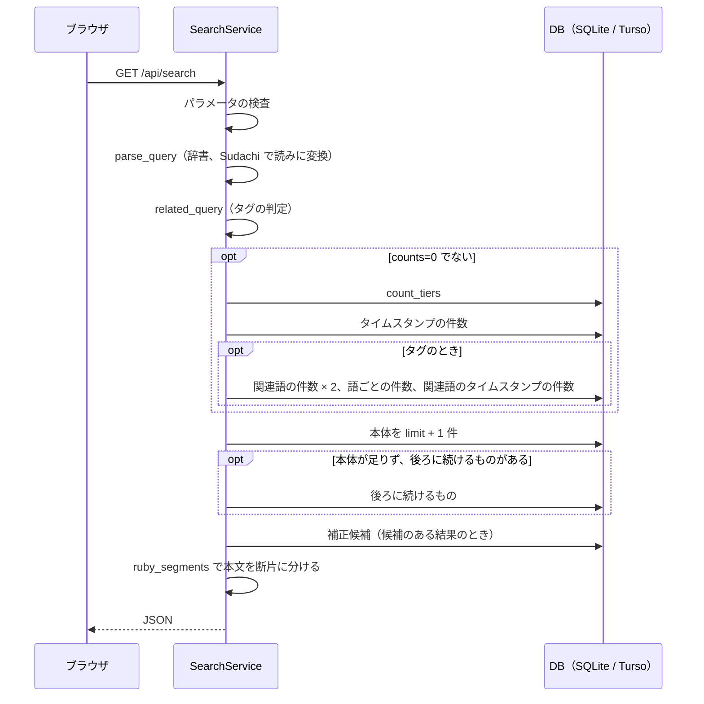

# AZKi Moment Search API 設計書

| 項目 | 内容 |
|---|---|
| 対象 | `src/azkims/server.py`、`vercel/api/index.py`、`vercel/vercel.json`、`web/src/api.ts` |
| 版 | 第 2 版（2026-11-11）。第 1 版（2026-11-02）を置き換える |
| 確認方法 | ソースを読み、ローカルの `SearchService` と本番（β版）に実際にリクエストして確認。応答例は実データ |
| 関連文書 | [エンティティ一覧](01_エンティティ一覧.md) / [画面設計書](02_画面設計書.md) / [機能設計書](03_機能設計書.md) / [単体テスト設計書](05_単体テスト設計書.md) |

## 1. 概要

検索画面のための読み取り専用 API です。手元と公開側で同じコード（`SearchService`、`make_handler`）が動きます。

| 項目 | 手元 | プレビュー | 本番（β版） |
|---|---|---|---|
| ベース URL | `http://127.0.0.1:8765` | `https://azki-moment-search-preview.vercel.app` | `https://azki-moment-search.vercel.app` |
| 起動 | `azkims serve` | Vercel の Python 関数 | Vercel の Python 関数 |
| DB | `data/azkims.sqlite`（読み取り専用） | Turso（HTTP） | Turso（HTTP）。今はプレビューと同じ DB |
| アクセス制御 | 127.0.0.1 でのみ待ち受け | Vercel のログインが要る（未ログインは 302） | **誰でも呼べる** |
| 回数制限 | なし | なし（保護の内側） | Vercel Firewall で `/api/` を IP ごと 60 秒 30 回、超えたら 429 |
| 認証 | なし | Vercel 側 | なし |
| データの更新 | なし | なし | なし |

回数制限は Vercel の画面の設定で、リポジトリにはありません。本書では試していません（試すと本番の読み取りを使うため）。

### 1.1 エンドポイント一覧

| ID | メソッド | パス | 説明 | 本番の確認（2026-11-11） |
|---|---|---|---|---|
| API-01 | GET | `/api/search` | 発言とタイムスタンプの検索 | 200、結果あり |
| API-02 | GET | `/api/context` | 指定時刻の前後の発言 | 手元のみ確認 |
| API-03 | GET | `/api/stats` | データの概要 | 200 |
| API-04 | GET | `/api/members` | 「ホロメンから探す」の一覧（2026-11-10 追加） | 200 |
| - | GET | 上記以外 | 手元のみ、`web/dist` の静的ファイル。不明なパスは `index.html` | |

公開側では `vercel.json` が `/api/(.*)` を `/api/index.py?route=$1` に転送し、`do_GET` がパスに戻します。静的ファイルは Vercel が配信します。

### 1.2 共通仕様

| 項目 | 内容 |
|---|---|
| 応答形式 | JSON（UTF-8）。`Content-Type: application/json; charset=utf-8` |
| 文字 | 非 ASCII はエスケープせずそのまま返す |
| キャッシュ | 公開側は、成功した応答に `Cache-Control: public, s-maxage=86400, stale-while-revalidate=86400`（CDN で 1 日。ブラウザには `public` だけが届く）。失敗（400・500・503）とローカルの serve は `no-store`。2026-11-11 に本番で MISS → HIT を確認（ISS-10 は解消。以前は全応答が `no-store` だった） |
| 検索エンジン | 全パスに `X-Robots-Tag: noindex, nofollow` |
| セキュリティ用ヘッダー | 全パスに `X-Content-Type-Options: nosniff`、`X-Frame-Options: DENY`、`Content-Security-Policy`（`vercel.json`）。2026-11-11 までは `/api` に付いていなかった（規則が `/api` の振り分けより後ろだった）。プレビューで確認済み、本番は次の publish から |
| Host ヘッダー | ローカルの serve は `127.0.0.1:<port>`・`localhost:<port>` 以外を 403 `{"error": "unknown host"}` にする（DNS rebinding 対策）。公開側は見ない |
| 同じ名前のパラメータ | 最初の値を使う |
| 数値パラメータ | 変換できなければ既定値、範囲外は範囲内に丸める。エラーにはしない |
| GET 以外 | HTTP 501（`BaseHTTPRequestHandler` の既定の動作） |

### 1.3 エラー応答

```json
{ "error": "検索語は 2 文字以上にしてください: 'a'" }
```

| ステータス | 条件 | `error` の内容 |
|---|---|---|
| 400 | 検索語が空 | 検索語を入力してください |
| 400 | 検索語が 2 文字未満 | 検索語は 2 文字以上にしてください: 'a' |
| 400 | 検索語が 6 個以上 | 検索語は 5 個までです |
| 400 | `tab` が不正 | unknown tab: {値} |
| 400 | `sort` が不正 | unknown sort: {値}（どのタブでも。ISS-09 は解消） |
| 400 | 完全一致で 3 文字未満 | 完全一致は 3 文字以上にしてください（2 文字は完全一致を外すと探せます）（ISS-05） |
| 400 | 2 文字で読みも無い語（記号だけ） | 2 文字の記号だけでは探せません: '!?'（ISS-05） |
| 400 | `from`・`to` が `YYYY-MM-DD` でない | 日付は YYYY-MM-DD の形で指定してください: {値}（ISS-11） |
| 400 | `video_id` が無い | video_id が必要です |
| 404 | `/api/` 配下の未定義のパス | not found |
| 404 | 手元で画面が未ビルド | 画面がビルドされていません（web で npm run build） |
| 429 | 本番で回数制限を超えた | Vercel Firewall の応答（本書では未確認） |
| 500 | その他の例外 | 検索中にエラーが起きました。時間をおいて試してください（定型文。例外はログだけ。ISS-07 は解消） |
| 501 | GET 以外 | HTML のエラー応答 |
| 503 | 手元で DB が無い | DB がありません。`azkims build` を実行してください |
| 503 | Turso に接続できない、SQL を実行できない、無料枠の上限 | データベースに接続できません。時間をおいて試してください |
| 503 | Turso を待つ時間が API 1 回の合計で 12 秒を超えそう | 同上（関数の上限 15 秒の前に打ち切る。ISS-08） |
| 504 など | それでも関数が 15 秒で時間切れ | Vercel の応答（未確認） |

## 2. API-01 検索

```http
GET /api/search?q=開拓者&tab=match&sort=new&limit=20
```

### 2.1 リクエスト

| パラメータ | 型 | 必須 | 既定 | 範囲 | 説明 |
|---|---|---|---|---|---|
| `q` | 文字列 | ○ | | 2 文字以上の語を 1〜5 個 | 検索語。半角スペースで AND |
| `tab` | 文字列 | | `match` | `match` / `related` / `maybe` / `readout` / `ts` | 取得する結果の種類 |
| `word` | 文字列 | | | | 関連語の絞り込み。`tab=related` でのみ有効 |
| `title` | 文字列 | | | | 配信タイトルの部分一致 |
| `from`、`to` | 文字列 | | | `YYYY-MM-DD` | 配信日の範囲。形が違えば 400（ISS-11） |
| `sort` | 文字列 | | `new` | `new` / `old` / `relevance` | 並び順。画面は `new`、`old` だけを使う |
| `exact` | 文字列 | | | `1` のときだけ有効 | 完全一致。3 文字以上だけ |
| `cursor` | 文字列 | | 先頭 | 前の応答の `cursor` | 続きの位置 |
| `limit` | 整数 | | 20 | 1〜50 | 取得件数 |
| `counts` | 文字列 | | 数える | `0` のときだけ数えない | 件数を数えるか |

**第 1 版からの変更:** `offset` を廃止し `cursor` に変えました。`counts=0` と `tab=readout` を追加しました（2026-11-09〜10）。

### 2.2 レスポンス

| 項目 | 型 | 説明 |
|---|---|---|
| `terms` | 配列 | 解析した検索語。`surface`（表記）と `reading`（読み。読みで探さないときは空） |
| `related` | オブジェクト / null | 検索語がホロメン・ユニットのとき。完全一致のとき、`counts=0` のときは null |
| `related.tag` | 文字列 | タグの名前 |
| `related.words` | 配列 | 関連語タブの語ごとの件数。多い順。`{word, count}` |
| `counts` | オブジェクト / null | タブごとの総件数。`match`, `related`, `maybe`, `readout`, `ts`。`counts=0` なら null |
| `tiers` | オブジェクト / null | tier ごとの件数。キーは 原文、補正、AI修正、読み、候補、読み(部分)、スパチャ読み。`counts=0` なら null |
| `tab` | 文字列 | 応答のタブ |
| `limit` | 整数 | 適用した値 |
| `cursor` | 文字列 / null | 続きを取るときに渡す値。無ければ null |
| `has_more` | 真偽 | `cursor` が null でないか |
| `hits` | 配列 | 結果 |

`counts` は `word` や `tab` によらず同じ集計です。`word` で絞っても `counts.related` は減りません。

**件数の内訳**

| キー | 中身 |
|---|---|
| `match` | tier 0〜3 の字幕 |
| `related` | 関連語（`confident = 1`）の発言。検索語そのものの発言も含む |
| `maybe` | tier 4、5 の字幕 + 話題でない配信の weak の関連語（一致タブと重ならないもの） |
| `readout` | tier 8 の字幕 |
| `ts` | タイムスタンプの一致 + 関連語のタイムスタンプ（検索語が全部書かれた行を除く） |

**`hits` の要素**

| 項目 | 型 | 字幕 | タイムスタンプ |
|---|---|---|---|
| `kind` | 文字列 | `caption` | `timestamp` |
| `id` | 文字列 | `u{発言 ID}`。**build で変わる** | `t{行 ID}`。**build で変わる** |
| `video_id` | 文字列 | 動画 ID | 動画 ID |
| `title` | 文字列 | 配信タイトル | 配信タイトル |
| `upload_date` | 文字列 / null | 配信日 | 配信日 |
| `sec` | 整数 | 再生開始の秒。発言の 2 秒前 | 書かれた時刻 |
| `ms` | 整数 | 発言の開始ミリ秒 | `sec × 1000` |
| `timestamp` | 文字列 | 発言の時刻 `H:MM:SS` | 書かれた時刻 `H:MM:SS` |
| `url` | 文字列 | YouTube の秒数付き URL | 同左 |
| `text` | 文字列 | 表示用の本文（`text_ai`、無ければ `text_fuzzy`、無ければ `text`） | 本文 |
| `text_raw` | 文字列 | 字幕原文 | `text` と同じ |
| `label` | 文字列 | 原文 / 補正 / AI修正 / 読み / 候補 / 読み(部分) / スパチャ読み / 関連語 | 原文 / 読み / 読み(部分) / 関連語 |
| `tier` | 整数 | 0〜8 | 0, 3, 5, 6 |
| `candidates` | 配列 | 補正候補 `{surface, canonical, distance}`。画面は表示しない | 空 |
| `related_words` | 配列 | 一致した関連語 | 同左（推しマークのこともある） |
| `quotes` | 配列 | 空 | 「」内の語句 |
| `segments` | 配列 | 本文の断片 | 本文 1 つ |

`segments` の要素は `{text}`、補正箇所は `{text, raw, kind}` です。`raw` は字幕の原文、`kind` は `confirmed`（辞書）/ `candidate`（補正候補）/ `ai`（AI修正）です。

### 2.3 タブごとの動作

| タブ | 本体 | 本体の後ろに続けるもの |
|---|---|---|
| `match` | tier 0〜3 の字幕 | なし |
| `related` | `confident = 1` の関連語の発言。`word` で絞れる。タグでなければ空 | なし |
| `maybe` | tier 4、5 の字幕 | タグのとき、`confident = 0` の関連語の発言 |
| `readout` | tier 8 の字幕 | なし |
| `ts` | タイムスタンプ | タグのとき、関連語のタイムスタンプ |

### 2.4 ページ送り（cursor）

件数を数えずに続きの有無を知るため、`limit + 1` 件を取ります（`server._page`）。

| `cursor` の値 | 意味 |
|---|---|
| 空 | 本体の先頭から |
| `"20"` | 本体の 20 件目の次から |
| `"x5"` | 本体を読み終え、後ろに続けるものの 5 件目の次から |
| null（応答） | 続きなし |

本体がちょうど `limit` 件で終わり、後ろに続けるものがあるときは、次の `cursor` は `"x0"`（続きの先頭）です（`test_page_joins_primary_and_extra` で確認）。

画面は、2 回目以降（さらに読み込む・タブ・語のチップ）を `counts=0` で呼び、最初の検索の `counts`・`related`・`tiers` を使い続けます（`api.withCounts`）。

### 2.5 応答例

一致タブ（`q=開拓者`。本番、2026-11-11）

```json
{
  "terms": [{ "surface": "開拓者", "reading": "カイタクシヤ" }],
  "related": null,
  "counts": { "match": 3278, "related": 0, "maybe": 886, "readout": 3, "ts": 241 },
  "tiers": { "原文": "…", "補正": "…", "AI修正": "…", "読み": "…", "候補": "…", "読み(部分)": "…", "スパチャ読み": 3 },
  "tab": "match",
  "limit": 20,
  "cursor": "20",
  "has_more": true,
  "hits": [
    {
      "kind": "caption",
      "label": "原文",
      "tier": 0,
      "upload_date": "2026-11-04",
      "segments": [{ "text": "…" }]
    }
  ]
}
```

`tiers` の値と `hits` の 20 件の大半は省略しています。

続きのページ（`q=開拓者&cursor=20&counts=0`。本番）

```json
{ "counts": null, "related": null, "tiers": null, "cursor": "40", "has_more": true, "hits": ["…20 件…"] }
```

関連語タブ（`q=天音かなた&tab=related`。本番）

```json
{
  "related": { "tag": "天音かなた", "words": [{ "word": "かなたん", "count": "…" }] },
  "counts": { "match": 15, "related": 1615, "maybe": 189, "readout": 0, "ts": 363 },
  "hits": [{ "kind": "caption", "label": "関連語", "tier": 6, "related_words": ["…"] }]
}
```

### 2.6 処理の流れ



### 2.7 SQL の実行回数と時間

2026-11-11 にローカル（589 配信）で実測しました。`meta` を 1 行読む SQL を含みます。Turso では SQL ごとに HTTP の往復が 1 回発生します。

| 検索 | SQL | 手元の時間 | 本番の時間 |
|---|---|---|---|
| `q=配信`（最初の検索） | 5 | 0.09 秒 | 3.2 秒 |
| `q=開拓者`（最初の検索） | 5 | 0.04 秒 | 2.2〜4.8 秒 |
| `q=開拓者&tab=ts` | 4 | 0.03 秒 | 2.0 秒 |
| `q=開拓者&tab=maybe` | 5 | 0.06 秒 | 未測定 |
| `q=天音かなた&tab=related` | 8 | 0.04 秒 | 2.7 秒 |
| `q=天音かなた&tab=maybe` | 10 | 0.04 秒 | 未測定 |
| `q=開拓者&cursor=20&counts=0` | 2 | 0.01 秒 | 1.0 秒 |
| `q=天音かなた&tab=related&word=かなたん&counts=0` | 1 | 0.01 秒 | 未測定 |
| `q=配信&exact=1`（全件走査） | 4 | **1.06 秒** | 2026-11-11 に Turso で 1,457,138 行・約 15 秒。**今は 400 で断る**（ISS-05） |

本番の時間はこの PC から測った値で、回数が少なく（各 1〜2 回）、ばらつきがあります。手元との差の大半は Turso への往復と見られますが、内訳は確かめていません。

読み取りの行数（Turso の `rows_read`）は、[機能設計書 7.5](03_機能設計書.md#75-公開側の構成と無料枠) を参照してください。

## 3. API-02 前後の発言

```http
GET /api/context?video_id=M4utnSkzW-U&ms=6594800
```

### 3.1 リクエスト

| パラメータ | 型 | 必須 | 既定 | 範囲 | 説明 |
|---|---|---|---|---|---|
| `video_id` | 文字列 | ○ | | | 動画 ID |
| `ms` | 整数 | | 0 | 0〜100,000,000 | 基準の時刻（ミリ秒） |

### 3.2 レスポンス

`start_ms` が `ms` の前後 30 秒にある発言を、時刻順に返します。

| 項目 | 型 | 説明 |
|---|---|---|
| `video_id` | 文字列 | 動画 ID |
| `utterances[].id` | 整数 | 発言 ID |
| `utterances[].start_ms` | 整数 | 開始ミリ秒 |
| `utterances[].text` | 文字列 | AI修正 があればその文、無ければ確定補正後の本文 |
| `utterances[].text_raw` | 文字列 | 字幕原文 |
| `utterances[].ai` | 真偽 | `text` が AI修正 か（2026-11-06 追加） |

```json
{
  "video_id": "M4utnSkzW-U",
  "utterances": [
    { "id": 8210, "start_ms": 6572119, "text": "神奈川県神奈川県になってました。", "text_raw": "神奈川県神奈川県になってました。", "ai": false }
  ]
}
```

存在しない `video_id` と、外した配信の `video_id` は 200 で空の配列を返します（2026-11-11 から配信の表を見る。配信の行を 1 回引くだけで、実測 19 行）。除外した配信の発言は build も作りません（[機能設計書 ISS-01](03_機能設計書.md#iss-01-除外した配信の発言解消)）。

## 4. API-03 データの概要

```http
GET /api/stats
```

パラメータはありません。

| 項目 | 型 | 説明 |
|---|---|---|
| `streams` | 整数 | 検索対象かつ字幕取得済みの配信数 |
| `utterances` | 整数 | 発言数。公開用 DB は `meta` の保存値 |
| `timestamp_entries` | 整数 | タイムスタンプ数。公開用 DB は `meta` の保存値 |
| `date_from`、`date_to` | 文字列 / null | 最も古い・新しい配信日 |
| `built_at` | 文字列 / null | DB の作成日時（UTC） |

本番の応答（2026-11-11）:

```json
{
  "streams": 589,
  "utterances": 694767,
  "timestamp_entries": 49353,
  "date_from": "2018-12-23",
  "date_to": "2026-11-05",
  "built_at": "2026-11-10T11:14:13+00:00"
}
```

## 5. API-04 ホロメンの一覧

```http
GET /api/members
```

パラメータはありません。build が `meta.members` に保存した JSON を 1 行読むだけです。

| 項目 | 型 | 説明 |
|---|---|---|
| `members[].name` | 文字列 | 関連語のタグの名前（ホロメンの名前） |
| `members[].mark` | 文字列 | 推しマーク。無い人は空文字。異体字セレクタを含む表記のまま |
| `members[].nickname` | 文字列 | 検索に使う呼び名。名前・呼び名のうち、AZKi の字幕に最も多く出るもの |
| `members[].count` | 整数 | 名前・呼び名の一致の合計 |

並びは推しマークの表の順（期生順）で、推しマークの無い人はその後ろです。字幕に一度も出ない人は載りません。現在 71 人です。

```json
{
  "members": [
    { "name": "ときのそら", "mark": "🐻💿", "nickname": "そらちゃん", "count": 786 },
    { "name": "ロボ子さん", "mark": "🤖", "nickname": "ロボ子さん", "count": 310 },
    { "name": "さくらみこ", "mark": "🌸", "nickname": "みこち", "count": 603 }
  ]
}
```

## 6. 画面側の呼び出し

`web/src/api.ts` が型と呼び出しを定義します。API の形式を変えるときは、`server.py`、`web/src/api.ts`、`DESIGN.md` 10.2 を合わせて直す決まりです。

| 関数 | 呼ぶ API | 呼ぶ場面 |
|---|---|---|
| `searchApi(params, {cursor, limit, counts})` | API-01 | 検索（counts あり）、タブ・語のチップ・さらに読み込む（counts=0） |
| `withCounts(page, prev)` | なし | counts=0 のページに、前の件数・関連語・tier を合わせる |
| `contextApi(videoId, ms)` | API-02 | 「前後の発言」を開いたとき |
| `statsApi()` | API-03 | ページを開いたとき（「このサイトについて」に表示） |
| `membersApi()` | API-04 | 「ホロメンから探す」を初めて開いたとき（1 回だけ） |

空文字の値は URL に含めません。`exact` が真なら `exact=1`、`counts` が偽なら `counts=0` を送ります。応答が 2xx でないときは `ApiError` を投げ、`error` の内容を画面に出します。

ページを開いて 1 回検索すると、API の呼び出しは `/api/stats` と `/api/search` の 2 回です。

## 7. システムが利用する外部 API

利用者が直接呼ぶものではありません。参考として載せます。

### 7.1 Turso データ API（`turso.py`）

| 項目 | 内容 |
|---|---|
| エンドポイント | `POST https://{host}/v2/pipeline` |
| 認証 | `Authorization: Bearer {読み取り専用トークン}` |
| 要求 | `{"requests": [{"type": "execute", "stmt": {"sql": …, "args": […]}}, {"type": "close"}]}` |
| タイムアウト | API 1 回（接続 1 つ）の合計で 12 秒。各 SQL は残り時間だけ待つ（2026-11-11、ISS-08） |
| やり直し | 通信の失敗のみ 1 回（残り時間があるとき） |
| 失敗時 | `TursoError` → API は 503 |

`TursoConnection` は `sqlite3` の接続と同じ形（`execute`、`fetchone`、`fetchall`、列名アクセス）を持つので、`search.py` は接続先を意識しません。

### 7.2 Turso Platform API（`publish.py`）

`azkims publish` だけが手元から使います。トークンは `data/turso.env` にあり、DB を削除できる権限があります。

| 操作 | メソッド | パス |
|---|---|---|
| DB の作成 | POST | `/v1/organizations/{org}/databases` |
| トークンの発行 | POST | `/v1/organizations/{org}/databases/{name}/auth/tokens?expiration=…&authorization=…` |
| DB の削除 | DELETE | `/v1/organizations/{org}/databases/{name}` |
| アップロード | POST | `https://{DB のホスト}/v1/upload` |

| トークン | 権限 | 期限 | 用途 |
|---|---|---|---|
| 書き込み | full-access | 1 時間 | アップロード |
| 読み取り | read-only | 無期限 | Vercel の環境変数（プレビューと本番） |

### 7.3 Vercel CLI（`publish.py`）

`npx vercel` を `deploy/` で実行します。ログイン情報は手元のものを使います。

| 操作 | コマンド |
|---|---|
| 環境変数の登録 | `vercel env add {名前} --environment preview（または production） --force --sensitive --yes`（値は標準入力） |
| プレビューのデプロイ | `vercel deploy --yes` |
| 本番のデプロイ（ドメインに付けない） | `vercel deploy --prod --skip-domain --yes` |
| 本番への切り替え | `vercel promote {URL} --yes` |
| 動作確認 | `vercel curl {パス} --deployment {URL} --yes` |
| 固定 URL の切り替え | `vercel alias set {URL} azki-moment-search-preview.vercel.app` |

Windows のコマンド経由では引数の日本語が化けるので、検索語はファイルに書いて `--data-urlencode key@file` で渡します。本書の確認でも、Git Bash の curl に日本語を直接渡すと 0 件になりました。

### 7.4 YouTube（`youtube.py`）

yt-dlp を経由します。API キーと Cookie は使いません。

| 用途 | 内容 |
|---|---|
| 一覧 | `extract_flat`。動画の本体は取得しない |
| 字幕 | `skip_download`、`writeautomaticsub`、`subtitlesformat = json3` |
| コメント | `getcomments`、人気順、親 60 件まで。`author_id` で絞る |

## 8. 公開時の確認項目

開発の決まりです。デプロイの後、次の API が 200 で正しい結果を返すことを確かめてから報告します。302 だけでは確認になりません。

| 確認 | リクエスト | 期待 | 2026-11-11 の本番 |
|---|---|---|---|
| 件数 | `/api/stats` | `streams`、`utterances` が 1 以上 | 589、694,767 |
| 3 文字以上 | `/api/search?q=開拓者` | `counts.match` が 1 以上 | 3,278 |
| 2 文字 | `/api/search?q=配信` | `counts.match` が 1 以上 | 3,609 |
| 関連語 | `/api/search?q=天音かなた&tab=related` | `hits` がある | 20 件 |
| タイムスタンプ | `/api/search?q=開拓者&tab=ts` | `hits` がある | 20 件 |

`azkims publish` はこの確認を、プレビュー、本番のデプロイ、本番の URL の 3 か所で行います。`azkims smoke {URL}` でも同じ確認ができます。

## 9. API の課題

| ID | 内容 | 状態 |
|---|---|---|
| ISS-05 | 完全一致の 2 文字で全件走査になる | **解消**（2026-11-11。400 で断る） |
| ISS-07 | 500 エラーが例外の内容を返す。**本番は誰でも呼べる** | **解消**（2026-11-11。定型文） |
| ISS-08 | Turso の待ち時間が関数の実行時間の上限を超え得る | **解消**（2026-11-11。合計 12 秒で打ち切り。本番では未再現） |
| ISS-09 | `tab=ts` で `sort` を無視し、不正な値も通す | **解消**（2026-11-11） |
| ISS-10 | `Cache-Control: no-store` のため、CDN のキャッシュが効かない | **解消**（2026-11-11。本番で 2 回目が HIT） |
| ISS-11 | `from`、`to` の形式を検査しない | **解消**（2026-11-11。400） |

詳細は [機能設計書 9 章](03_機能設計書.md#9-課題一覧) を参照してください。
